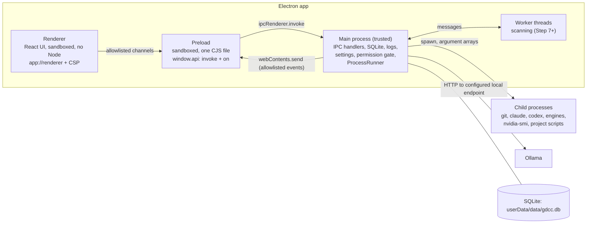

# Architecture

How GameDev Command Center is built. Written in Step 2 (2026-10-24) for Steps 3–29. [MASTER_SPEC.md](MASTER_SPEC.md) stays the source of truth: this file says *how*, the spec says *what*. When a later step changes the design, it updates this file and records why in [DECISIONS.md](DECISIONS.md). `node scripts/check-docs.mjs` checks the dependency pins (section 1) and the module table (section 4).

In this file "§N" always means a spec section; sections of this file are called "section N". Contents: 1 Runtimes and dependencies · 2 Process model · 3 Folder structure · 4 Modules · 5 Interfaces · 6 IPC · 7 Security model · 8 Data model and storage · 9 Feature-status manifest · 10 Errors · 11 Logging and crash capture · 12 Processes and shutdown · 13 Provider and engine facts · 14 Testing strategy · 15 Risks · 16 What Step 3 does · 17 What Step 4 did · 18 What Step 5 did · 19 What Step 6 did

## 1. Runtimes and dependencies

### Runtimes

| Runtime | Version | Why | Supported until | Source (checked 2026-10-24) |
|---|---|---|---|---|
| Node.js (development: npm, Vite, Vitest, ESLint) | 24.22.1 LTS "Krypton" | Same major as the Node inside Electron 45, so unit tests run on the runtime the app uses. Meets every tool's engine range (Vite ≥22.12, Vitest ^24, ESLint ≥24, jsdom ≥24.15). `node:sqlite` is a release candidate since 24.15.0 | 2028-04-30 (maintenance LTS since 2026-10-20) | https://github.com/nodejs/Release (schedule.json), https://nodejs.org/dist/index.json |
| Electron | 45.0.0: Chromium 156, Node 24.22.0, V8 15.6 | Newest stable major, so the longest security-support window | 2027-04-27 (tentative) | https://releases.electronjs.org/schedule, https://releases.electronjs.org/releases.json |

The Node.js install is decision D-012. Electron supports only the latest three stable majors, so Steps 27 and 28 re-check the Electron version before release.

### Pinning rules

- `package.json` pins every package to an exact version (no `^` or `~`) and the lockfile is committed. `.npmrc` sets `engine-strict=true` and `package.json` sets `"engines": { "node": ">=24.15.0 <25" }`, so a wrong Node version fails at install with a clear message.
- A package is added or upgraded only together with its row below. From Step 3 on, the docs check fails if `package.json` has a package that is missing here, or a different version.
- A step that installs a package re-checks it first. It may take a newer patch of the same major and updates the row (version and date). Anything bigger is a decision with an ADR.

### Pinned packages

<!-- DEPS:BEGIN -->
| Package | Version | License | Verified | Step | Purpose | Source |
|---|---|---|---|---|---|---|
| electron | 45.0.0 | MIT | 2026-10-24 | 3 | Desktop shell | https://www.electronjs.org/docs/latest |
| electron-vite | 6.0.0 | MIT | 2026-10-24 | 3 | Dev server and build for main, preload and renderer | https://electron-vite.org/guide/ |
| vite | 8.3.5 | MIT | 2026-10-24 | 3 | Frontend build (peer of electron-vite and the React plugin) | https://vite.dev/guide/ |
| @vitejs/plugin-react | 6.1.2 | MIT | 2026-10-24 | 3 | React support for Vite | https://github.com/vitejs/vite-plugin-react |
| react | 19.3.1 | MIT | 2026-10-24 | 3 | UI library | https://react.dev |
| react-dom | 19.3.1 | MIT | 2026-10-24 | 3 | React DOM renderer | https://react.dev |
| typescript | 6.0.3 | Apache-2.0 | 2026-10-24 | 3 | Strict type checking; 6.0 is the newest line typescript-eslint supports | https://www.typescriptlang.org/docs/ |
| @types/node | 24.19.2 | MIT | 2026-10-24 | 3 | Node 24 types, matching Electron's Node | https://www.npmjs.com/package/@types/node |
| @types/react | 19.3.0 | MIT | 2026-10-24 | 3 | React types | https://www.npmjs.com/package/@types/react |
| @types/react-dom | 19.3.0 | MIT | 2026-10-24 | 3 | React DOM types | https://www.npmjs.com/package/@types/react-dom |
| eslint | 10.13.0 | MIT | 2026-10-24 | 3 | Linting | https://eslint.org/docs/latest/ |
| @eslint/js | 10.0.1 | MIT | 2026-10-24 | 3 | ESLint recommended rules | https://www.npmjs.com/package/@eslint/js |
| typescript-eslint | 8.72.0 | MIT | 2026-10-24 | 3 | TypeScript parser and rules (supports TypeScript >=4.8.4 <6.1.0) | https://typescript-eslint.io/users/dependency-versions/ |
| eslint-plugin-react-hooks | 7.1.1 | MIT | 2026-10-24 | 3 | Rules of Hooks | https://react.dev/reference/eslint-plugin-react-hooks |
| globals | 17.13.0 | MIT | 2026-10-24 | 3 | Browser and Node globals for the ESLint config | https://www.npmjs.com/package/globals |
| prettier | 3.9.10 | MIT | 2026-10-24 | 3 | Formatting | https://prettier.io/docs/ |
| vitest | 5.0.5 | MIT | 2026-10-24 | 3 | Unit, integration and component tests | https://vitest.dev/guide/ |
| @playwright/test | 1.64.1 | Apache-2.0 | 2026-10-24 | 3 | End-to-end tests of the real Electron app (experimental Electron support, v21+) | https://playwright.dev/docs/api/class-electron |
| zod | 4.6.7 | MIT | 2026-10-24 | 4 | Validation of IPC input, settings, imports and tool output | https://zod.dev |
| radix-ui | 1.8.1 | MIT | 2026-10-24 | 5 | Accessible unstyled primitives (dialog, menu, popover, tabs, tooltip) | https://www.radix-ui.com/primitives/docs/overview/introduction |
| cmdk | 1.1.1 | MIT | 2026-10-24 | 5 | Command palette | https://github.com/pacocoursey/cmdk |
| react-resizable-panels | 4.14.8 | MIT | 2026-10-24 | 5 | Resizable panels | https://github.com/bvaughn/react-resizable-panels |
| lucide-react | 1.61.0 | ISC | 2026-10-24 | 5 | Icons | https://lucide.dev/guide/packages/lucide-react |
| jsdom | 30.1.3 | MIT | 2026-10-24 | 5 | DOM for component tests | https://github.com/jsdom/jsdom |
| @testing-library/react | 16.3.3 | MIT | 2026-10-24 | 5 | Component tests | https://testing-library.com/docs/react-testing-library/intro/ |
| @testing-library/dom | 10.4.2 | MIT | 2026-10-24 | 5 | Peer of Testing Library React | https://testing-library.com/docs/dom-testing-library/intro/ |
| @testing-library/user-event | 14.6.8 | MIT | 2026-10-24 | 5 | Keyboard and pointer simulation in tests | https://testing-library.com/docs/user-event/intro/ |
| electron-builder | 26.18.0 | MIT | 2026-10-24 | 27 | Windows installer (NSIS) and portable build | https://www.electron.build |
| @electron/fuses | 2.1.3 | MIT | 2026-10-24 | 27 | Turn off unneeded Electron features in the packaged app | https://www.electronjs.org/docs/latest/tutorial/fuses |
<!-- DEPS:END -->

Main-process code has no runtime npm dependency except Zod, and renderer libraries are bundled by Vite. Step 3 decided (D-028): every package is listed under `devDependencies`, because electron-vite bundles main, preload and renderer into `out/`, so the packaged app (Step 27) ships those bundles and no `node_modules`. Electron-vite only leaves a package external when it is under `dependencies`, so a package that must stay external (a native module, if one is ever added) goes there with its own ADR.

### Considered and not used

| Candidate | Version checked | Why not |
|---|---|---|
| better-sqlite3 | 13.0.3 | Native module: it must be rebuilt for Electron's ABI and again for Vitest under system Node. `node:sqlite` is built into both. Electron fixed `require('node:sqlite')` in July 2025 (electron/electron#47706, backported to 36–38). better-sqlite3 is the fallback behind the same `Db` wrapper if `node:sqlite` ever blocks us. |
| @electron-forge/cli with @electron-forge/plugin-vite | 8.0.1 | Forge's docs still say "As of Electron Forge v7.5.0, Vite support for Electron Forge has been marked as experimental". |
| @quick-start/create-electron template, @electron-toolkit/* | 1.0.31, preload 3.0.2 | The template's preload exposes a generic `ipcRenderer` to the renderer and offers `electron-updater`; these break the IPC rules (section 6) and spec §24. Step 3 writes the small scaffold by hand in electron-vite's documented layout. |
| typescript 7 (native compiler) | 7.0.2 | typescript-eslint supports `>=4.8.4 <6.1.0`. Revisit when it supports 7. |
| electron-log, pino | 5.4.4, 10.4.0 | We need pattern-based secret redaction shared with context scanning, JSON lines and several rotated files. That is one small module; pino's rotation needs worker-thread transports that complicate packaging. |
| node-pty with @xterm/xterm | 1.1.0, 6.0.0 | Not needed now: Claude Code (`claude -p --output-format stream-json`) and Codex (`codex exec --json`) have documented structured non-interactive modes. node-pty is also a native module. A later step that needs an interactive terminal brings its own ADR. |
| Tailwind CSS with shadcn/ui, Mantine, Fluent UI | not pinned | CSS Modules and CSS custom properties are built into Vite (no dependency) and give full control of the dense dark look. Radix supplies the accessible behavior that shadcn/ui is built on anyway. |
| react-router, TanStack Router, Redux, Zustand, TanStack Query | not pinned | Eleven fixed sections in one window: a typed navigation state and a small query hook are enough. Revisit if the renderer outgrows them. |
| electron-updater | not pinned | Spec §24 Phase 6: no automatic updater that runs unverified updates. |
| happy-dom | 21.0.4 | jsdom is the more complete DOM for Testing Library; one DOM is enough. |

## 2. Process model



- **Main** is the only trusted code. It alone touches the filesystem, child processes, native dialogs and the network (the Ollama endpoint; launched CLIs make their own connections).
- **Preload** is sandboxed: it can only `require('electron')`, so it is bundled into one CommonJS file. It exposes `window.api` (section 6) and nothing else.
- **Renderer** is a sandboxed page with no Node, served from the custom `app://renderer` origin under a strict CSP. It only calls `window.api`.
- **Worker threads** (from Step 7) do slow scanning so the main event loop stays responsive. They get results and paths by message, never a database handle; the main thread owns the single SQLite connection.
- **Child processes** start only through `ProcessRunner` (section 12), which owns them until they exit.
- There is one window. The app requests a single-instance lock, and a second launch focuses the existing window.

## 3. Folder structure

The source layout is electron-vite's documented default (`src/main`, `src/preload`, `src/renderer`), so the build needs almost no configuration.

```text
src/
  shared/                 types and Zod schemas used by main, preload and renderer; no Node and no DOM
    ipc/                  channels.ts (names only, used by preload), contract.ts (schemas), events.ts
    errors.ts             ErrorCode and SerializedError
    feature-status.ts     the feature-status manifest (section 9)
    domain/               Project, Task, Milestone, AgentRun, ... types
  main/                   Electron main process (trusted)
    index.ts              composition root: builds services, registers IPC, opens the window
    app/                  window, app:// protocol, CSP, navigation guards, single instance, shutdown
    ipc/                  handler registration, sender validation, error mapping
    logging/              logger, rotation, redaction, activity log, crash capture
    storage/              database wrapper, migrations/, backups, repositories, export and import
    settings/             settings schema and store
    security/             permission gate, approvals dialog, path policy, sensitive-path denylist
    process/              ProcessRunner: ownership, timeouts, output caps, cancellation
    projects/             registry and type detection
    scanning/             bounded scanner, analyzers, audits, context packs, project memory, assets
    git/                  Git service (read-only first, gated writes later)
    providers/            ProviderAdapter and the ollama/, claude-code/, codex/ adapters; usage log
    sessions/             agent session manager and observed session events
    planning/             tasks/, milestones, agents/ (roles and workflows), routing/, queue/
    testing/              test runner and definition of done
    engines/              ProjectIntegration and the unreal/, blender/, godot/, vite/ adapters
    resources/            resource monitor and local-inference policy
    tooling/              tool registry, MCP management, bootstrap (Step 29)
  preload/
    index.ts              contextBridge.exposeInMainWorld('api', ...)
  renderer/
    index.html            CSP meta tag
    src/
      main.tsx
      app/                shell: sidebar, top bar, project switcher, command palette, inspector, navigation state
      design/             tokens.css and base components built on Radix
      features/           one folder per sidebar section (dashboard, projects, workbench, tasks, context,
                          git, testing, assets, integrations, activity, settings) plus implementation status
      lib/                api client, query hook, formatting
test/
  fixtures/               fixture projects (unreal, godot, vite, unity, blender, "unreal"-named web folder, ...)
                          and recorded provider responses
  mocks/                  mock providers and a fake window.api; the only place mocks may live
  e2e/                    Playwright tests against the built Electron app
  helpers/                temp-folder helpers (every test that writes uses a fresh temp folder)
scripts/                  check-docs.mjs, launch.cmd
assets/icon/              app icon
docs/                     spec, roadmap, architecture, decisions, status, known issues
```

Unit tests sit next to the code as `*.test.ts(x)`. Fixtures, mocks and end-to-end tests live in `test/`.

## 4. Modules

Each module from spec §4 has an owning folder and a public interface (sketched in section 5). Other modules import only a module's `index.ts`, never its internals.

<!-- MODULES:BEGIN -->
| Module (spec §4) | Folders | Interfaces | Built in |
|---|---|---|---|
| UI and navigation | `src/renderer/`, `src/main/app/` | NavState, Api, FeatureStatus | S3, S5, S24, S25 |
| Project registry | `src/main/projects/` | ProjectRegistry, ProjectDetection | S6 |
| Project scanning and context extraction | `src/main/scanning/` | ProjectReader, Scanner, Analyzer, ContextPackBuilder | S7, S9, S22 |
| Persistent storage | `src/main/storage/` | Db, Migrator, Repository, BackupService, ExportableTable | S4, S8 |
| AI provider adapters | `src/main/providers/` | ProviderAdapter, ProviderSession | S12, S14 |
| Agent session management | `src/main/sessions/` | SessionManager | S11, S12, S17 |
| Task planning and orchestration | `src/main/planning/` | TaskService, RunQueue, Router | S10, S11, S13 |
| Git integration | `src/main/git/` | GitService | S7, S15, S16 |
| Test runners | `src/main/testing/` | TestRunner | S23 |
| Engine integrations | `src/main/engines/` | ProjectIntegration | S18, S19, S20, S21 |
| System resource monitoring | `src/main/resources/` | ResourceMonitor | S13, S17 |
| Settings and security | `src/main/settings/`, `src/main/security/` | SettingsStore, PermissionGate, PathPolicy | S4, S15, S24 |
| Logging and recovery | `src/main/logging/`, `src/main/app/` (shutdown), `src/main/storage/` (backups) | Logger, Redactor, ActivityLog, ShutdownCoordinator | S4, S8, S17, S26 |
| External tool execution (spec §30) | `src/main/process/` | ProcessRunner | S4 |
| Tooling, MCP and skills (spec §29) | `src/main/tooling/` | ToolRegistry | S29 |
<!-- MODULES:END -->

### Dependency rules

- `src/renderer` imports only `src/shared` and its own files: never `src/main`, `electron` or `node:*`.
- `src/preload` imports only `electron` and `src/shared/ipc/channels.ts`.
- `src/shared` imports nothing from main, preload or renderer, and uses neither Node nor DOM APIs.
- In `src/main`, only `process/` uses `node:child_process`, only `storage/` uses `node:sqlite`, only `providers/ollama/` uses `fetch`, and only `app/` and `security/` (the approval dialog) create windows or dialogs. Project files are read only through `ProjectReader`.
- Adapters depend on interfaces, never the other way around. Composition (which adapter is used) happens only in `src/main/index.ts`.
- Code in `src/` never imports from `test/`.

Step 3 enforced the renderer and preload rules with ESLint `no-restricted-imports`; Step 4 added the main-process rules: a relative import into `storage/`, `process/`, `logging/`, `settings/`, `security/` or `ipc/` must go through that module's `index.ts` (tests are exempt), `node:child_process` is allowed only in `process/`, `node:sqlite` only in `storage/`, and the global `fetch` is banned in `src/main` until `providers/ollama/` exists. A planted violation of each failed lint. New modules join the index list in `eslint.config.mjs` (`MODULES_WITH_INDEX`) when they get an `index.ts`.

## 5. Interfaces

Sketches, not final code: Step 4 and later steps refine names and fields, keeping the shape. Types that are named but not spelled out here (`Project`, `Task`, `ScanResult`, `ContextPack`, `ModelInfo`, ...) are plain records in `src/shared/domain`, defined by the step that builds them. Every external input crosses a Zod schema before it reaches these types.

### Shared: errors, IPC results, navigation, feature status

```ts
// src/shared/errors.ts
export type ErrorCode =
  | 'INVALID_INPUT' | 'FORBIDDEN_SENDER' | 'NOT_FOUND' | 'ALREADY_EXISTS' | 'CONFLICT'
  | 'PATH_OUTSIDE_PROJECT' | 'PATH_SENSITIVE' | 'PERMISSION_REQUIRED' | 'PERMISSION_DENIED'
  | 'TOOL_NOT_INSTALLED' | 'TOOL_NOT_RUNNING' | 'TOOL_FAILED' | 'TIMEOUT' | 'CANCELLED'
  | 'OUTPUT_LIMIT' | 'LIMIT_REACHED' | 'UNSUPPORTED' | 'DB_CORRUPT' | 'DB_NEWER_THAN_APP'
  | 'MIGRATION_FAILED' | 'SHUTTING_DOWN' | 'INTERNAL';

export interface SerializedError { code: ErrorCode; message: string; hint?: string; retryable: boolean }
export type IpcResult<T> = { ok: true; value: T } | { ok: false; error: SerializedError };

// src/shared/domain/navigation.ts
export type NavSection = 'dashboard' | 'projects' | 'workbench' | 'tasks' | 'context' | 'git'
  | 'testing' | 'assets' | 'integrations' | 'activity' | 'settings' | 'status';
export interface NavState { section: NavSection; projectId?: string; detail?: string }

// src/shared/feature-status.ts (section 9)
export type FeatureState = 'available' | 'requires-setup' | 'upcoming' | 'experimental-off';
export interface FeatureStatus {
  id: string;            // 'projects.add', 'workbench.run-agent', ...
  label: string;
  section: NavSection;
  state: FeatureState;   // static state; integrations overlay 'requires-setup' at runtime
  step: number;          // roadmap step that builds or finishes it
  note?: string;
}
```

### IPC

```ts
// src/shared/ipc/channels.ts: names only, so the preload stays tiny
export const CHANNELS = ['app:getInfo', 'settings:get', 'settings:set', 'activity:list' /* each step adds its own */] as const;
export const EVENTS = ['activity:appended' /* 'session:event', 'process:output', 'resources:snapshot', ... */] as const;
export type ChannelName = (typeof CHANNELS)[number];
export type EventName = (typeof EVENTS)[number];

// src/shared/ipc/contract.ts: one request and one response schema per channel
export const contract = {
  'app:getInfo': { request: z.undefined(), response: AppInfoSchema },
  // ...
} satisfies Record<ChannelName, { request: z.ZodType; response: z.ZodType }>;
export type RequestOf<C extends ChannelName> = z.input<(typeof contract)[C]['request']>;      // what the renderer sends
export type ParsedRequestOf<C extends ChannelName> = z.output<(typeof contract)[C]['request']>; // what the handler gets
export type ResponseOf<C extends ChannelName> = z.output<(typeof contract)[C]['response']>;

// window.api, exposed by src/preload/index.ts
export interface Api {
  invoke<C extends ChannelName>(channel: C, input: RequestOf<C>): Promise<IpcResult<ResponseOf<C>>>;
  on<E extends EventName>(event: E, listener: (payload: EventPayloadOf<E>) => void): () => void;
}

// src/main/ipc/handle.ts
export interface IpcContext { requestId: string; senderUrl: string }
export declare function handle<C extends ChannelName>(
  channel: C,
  fn: (input: ParsedRequestOf<C>, ctx: IpcContext) => Promise<ResponseOf<C>> | ResponseOf<C>,
): void;
```

### Logging and recovery

```ts
export type LogLevel = 'error' | 'warn' | 'info' | 'debug';
export interface Logger {
  error(msg: string, data?: Record<string, unknown>): void;
  warn(msg: string, data?: Record<string, unknown>): void;
  info(msg: string, data?: Record<string, unknown>): void;
  debug(msg: string, data?: Record<string, unknown>): void;
  child(module: string): Logger;
  flush(): Promise<void>;
}

export interface Redactor {
  redact(text: string): string;            // secret patterns and the home folder (shown as ~)
  redactValue<T>(value: T): T;             // deep copy with redacted strings and secret-named keys
}

export type ActivitySeverity = 'info' | 'warning' | 'error';
export interface ActivityEvent {
  id: string; occurredAt: string; kind: string; severity: ActivitySeverity; summary: string;
  projectId?: string; taskId?: string; details?: Record<string, unknown>;
}
export interface ActivityLog {
  record(event: Omit<ActivityEvent, 'id' | 'occurredAt'>): ActivityEvent;   // redacts, stores, emits 'activity:appended'
  list(filter: { projectId?: string; kinds?: string[]; before?: string; limit: number }): ActivityEvent[];
}

export interface ShutdownCoordinator {
  register(name: string, order: number, stop: (signal: AbortSignal) => Promise<void>): void;
  shutdown(reason: string): Promise<void>;   // runs stops in order, each with a deadline (section 12)
}
```

### Storage

```ts
export type SqlValue = string | number | bigint | null | Uint8Array;
export interface Db {
  run(sql: string, ...params: SqlValue[]): { changes: number };
  get<T>(sql: string, ...params: SqlValue[]): T | undefined;
  all<T>(sql: string, ...params: SqlValue[]): T[];
  transaction<T>(fn: () => T): T;          // BEGIN IMMEDIATE ... COMMIT, ROLLBACK on throw
  close(): void;                           // checkpoints the WAL
}

export interface Migration { version: number; name: string; sql: string; checksum: string }
export interface MigrationReport { from: number; to: number; backupPath?: string }
export interface Migrator {
  current(): number;
  pending(): Migration[];
  migrate(): Promise<MigrationReport>;     // verified backup first, then all pending in one transaction (section 8)
}

export type BackupReason = 'pre-migration' | 'manual' | 'scheduled' | 'pre-restore';
export interface BackupInfo { path: string; createdAt: string; reason: BackupReason; schemaVersion: number; sizeBytes: number }
export interface BackupService {
  create(reason: BackupReason): Promise<BackupInfo>;   // node:sqlite backup(), then quick_check on the copy
  list(): BackupInfo[];
  restore(path: string): Promise<void>;                // Step 8: confirm, back up current DB first
}

export interface Repository<T, Id = string> {
  get(id: Id): T | undefined;
  list(filter?: Partial<T>): T[];
  insert(row: T): void;
  update(id: Id, patch: Partial<T>): void;
  remove(id: Id): void;
}

// Step 8: every feature table registers itself for export and import
export interface ExportableTable<Row> {
  name: string;
  schema: z.ZodType<Row>;
  exportRows(): Row[];
  importRows(rows: Row[], mode: 'preview' | 'merge'): { inserted: number; updated: number; conflicts: string[] };
}
```

### Settings and security

```ts
// Settings is z.infer of one schema with a default for every key; each step adds its keys.
export interface SettingsStore {
  get<K extends SettingKey>(key: K): Settings[K];
  set<K extends SettingKey>(key: K, value: Settings[K]): void;   // validates; INVALID_INPUT on bad values
  all(): Settings;
  onChange(listener: (key: SettingKey) => void): () => void;
}

export type PermissionScope = 'read-audit' | 'project-write' | 'run-command' | 'destructive';
export interface PermissionRequest {
  scope: PermissionScope;
  projectId: string;
  taskId?: string;
  workingDir: string;                              // resolved by main, inside the project
  action: string;                                  // plain-language description built by main
  command?: { executable: string; args: readonly string[] };
  paths?: readonly string[];                       // project-relative
  requestedBy: { kind: 'user' } | { kind: 'agent-run'; runId: string };
}
export interface PermissionGrant {
  id: string; scope: PermissionScope; projectId: string; taskId?: string; workingDir: string;
  command?: { executable: string; args: readonly string[] };
  grantedAt: string; expiresAt?: string; revokedAt?: string;
}
export type PermissionDecision = { allowed: true; grantId: string } | { allowed: false; reason: string };
export interface PermissionGate {
  check(req: PermissionRequest): PermissionDecision;                  // reads stored grants only
  requestApproval(req: PermissionRequest): Promise<PermissionDecision>; // native dialog in main: the only way to create a grant
  revoke(grantId: string): void;
}

export interface PathPolicy {
  /** Resolves a project-relative path, following symlinks and junctions, and refuses anything outside `root`. */
  resolveInside(root: string, relativePath: string): Promise<string>;  // PATH_OUTSIDE_PROJECT
  isSensitive(relativePath: string): boolean;                          // denylist (section 7)
}
```

### Process execution

```ts
export interface ProcessSpec {
  executable: string;                    // absolute path from detection or settings, never from the renderer
  args: readonly string[];               // never a shell string
  cwd: string;                           // validated by the caller (project root or app folder)
  stdin?: string;                        // prompts and other free text go here, not into args
  env?: Readonly<Record<string, string>>;
  timeoutMs: number;
  maxOutputBytes: number;                // per stream; the tail is kept, the rest counted
  purpose: string;                       // shown in activity and logs
  owner: { kind: 'agent-run' | 'test-run' | 'git' | 'detection' | 'engine' | 'resource-probe'; id: string };
  projectId?: string;
}
export type ProcessStatus = 'exited' | 'timed-out' | 'cancelled' | 'output-limit' | 'spawn-failed';
export interface ProcessResult {
  status: ProcessStatus; exitCode: number | null;
  stdoutTail: string; stderrTail: string; truncated: boolean;
  startedAt: string; endedAt: string;
}
export interface OutputChunk { stream: 'stdout' | 'stderr'; text: string }
export interface RunHandle {
  readonly id: string;
  readonly pid: number | undefined;
  onOutput(listener: (chunk: OutputChunk) => void): () => void;
  readonly result: Promise<ProcessResult>;
  cancel(reason: string): Promise<void>;     // graceful step, grace period, then tree kill (section 12)
}
export interface ProcessRunner {
  start(spec: ProcessSpec): RunHandle;       // CONFLICT if the same owner already has a live process
  active(): ReadonlyArray<{ id: string; pid?: number; owner: ProcessSpec['owner']; purpose: string; startedAt: string }>;
  cancelAll(reason: string): Promise<void>;
}
```

### Projects and scanning

```ts
export type ProjectType = 'unreal' | 'unity' | 'godot' | 'web-vite' | 'web' | 'general-code' | 'custom';
export interface Evidence { path: string; detail: string }               // project-relative path
export interface ProjectDetection {
  type: ProjectType; engine?: string; engineVersion?: string;
  confidence: 'confirmed' | 'inferred'; evidence: Evidence[];            // never from the folder name alone
}

/** Read-only view of one registered project; every method refuses outside, sensitive and binary paths. */
export interface ProjectReader {
  readonly root: string;
  exists(rel: string): Promise<boolean>;
  stat(rel: string): Promise<{ kind: 'file' | 'dir'; sizeBytes: number; modifiedAt: string }>;
  list(rel: string): Promise<Array<{ name: string; kind: 'file' | 'dir' | 'link' }>>;   // links are reported, not followed
  readText(rel: string, maxBytes: number): Promise<string>;
}

export interface ProjectRegistry {
  add(root: string): Promise<Project>;            // root comes from the native folder dialog in main
  list(): Project[];
  get(id: string): Project | undefined;
  update(id: string, patch: ProjectPatch): Project;
  setTypeOverride(id: string, type: ProjectType | null): Project;
  remove(id: string): void;                       // removes the registry entry only, never files
  reader(id: string): ProjectReader;
}

export interface ScanBudget { maxFiles: number; maxDepth: number; maxMillis: number; maxFileBytes: number }
export interface Scanner {
  scan(reader: ProjectReader, budget: ScanBudget, signal: AbortSignal): Promise<ScanResult>;
}
export interface Finding { section: string; kind: 'confirmed' | 'inferred'; title: string; detail: string; evidence: Evidence[] }
export interface Analyzer { id: string; analyze(scan: ScanResult, reader: ProjectReader, signal: AbortSignal): Promise<Finding[]> }

export interface ContextPackBuilder {
  build(req: { projectId: string; taskId?: string; description: string; tokenBudget: number }): Promise<ContextPack>;
  isStale(pack: ContextPack): Promise<boolean>;  // compares stored size, mtime and hash per file
}
```

### Git

```ts
export type GitStatus =
  | { repo: false }
  | { repo: true; branch: string | null; ahead: number; behind: number; dirty: boolean;
      changes: Array<{ path: string; index: string; worktree: string }>; lfs: boolean };
export interface GitService {
  status(root: string, signal?: AbortSignal): Promise<GitStatus>;   // Step 7, read-only
  log(root: string, limit: number): Promise<Array<{ hash: string; subject: string; author: string; date: string }>>;
  // Step 15 adds init (with explanation and approval); Step 16 adds diff, commit, revert, checkpoints, worktrees, all through PermissionGate
}
```

### Planning, sessions and providers

```ts
export type TaskStatus = 'inbox' | 'planned' | 'ready' | 'in-progress' | 'review' | 'testing' | 'done'
  | 'blocked' | 'cancelled' | 'failed';
export interface TaskService {
  create(input: NewTask): Task;
  update(id: string, patch: TaskPatch): Task;
  transition(id: string, to: TaskStatus): Task;             // rejects invalid transitions
  addDependency(id: string, dependsOn: string): void;       // rejects cycles
  recommendNext(projectId: string): { task: Task; reasons: string[] } | null;
}

export type RunState = 'queued' | 'planning' | 'awaiting-approval' | 'running' | 'awaiting-review'
  | 'testing' | 'completed' | 'failed' | 'cancelled';
export type RoutingProfile = 'manual' | 'local-first' | 'balanced' | 'cloud-first';
export interface Router {
  choose(task: Task, role: AgentRole, profile: RoutingProfile): {
    providerId: string; model?: string; hosted: boolean; billing: 'subscription' | 'api' | 'local' | 'unknown'; reasons: string[];
  };                                                         // shown to the user before any cloud work
}
export interface RunQueue {
  enqueue(req: AgentRunRequest): AgentRun;                   // CONFLICT on a duplicate active run
  cancel(runId: string): Promise<void>;
  acquireWriter(projectId: string, runId: string): void;     // single writer per project; CONFLICT if held; survives restart
  releaseWriter(projectId: string, runId: string): void;
}

export interface SessionManager {
  start(runId: string): Promise<void>;                       // uses the routed adapter; write mode needs a grant
  cancel(runId: string): Promise<void>;
  events(runId: string, afterSeq?: number): SessionEvent[];  // persisted, observed events only
}

export interface ProviderCapabilities {
  models: 'list' | 'none';
  streaming: boolean;
  cancel: 'graceful' | 'kill-only' | 'none';
  structuredOutput: 'json-events' | 'json-result' | 'text';
  usage: 'reported' | 'none';             // never estimated by us
  resume: boolean;                         // only where the provider documents it
  modes: ReadonlyArray<'read-only' | 'plan' | 'write'>;
  hosted: boolean;                         // sends data off this PC
  billing: 'subscription' | 'api' | 'local' | 'unknown';
  contextLength: 'configurable' | 'reported' | 'unknown';
}
export interface Detection {
  installed: boolean; executablePath?: string; version?: string; endpoint?: string;
  reachable?: boolean; auth: 'signed-in' | 'signed-out' | 'unknown' | 'not-applicable';
  problems: Array<{ code: ErrorCode; message: string; hint?: string }>;
}
export interface SessionRequest {
  runId: string; projectId: string; workingDir: string; prompt: string; model?: string;
  mode: 'read-only' | 'plan' | 'write'; grantId?: string;    // 'write' is refused without a grant (Step 15)
  resumeProviderSessionId?: string; timeoutMs: number;
}
export type SessionEvent =
  | { kind: 'started'; providerSessionId?: string }
  | { kind: 'text'; text: string }
  | { kind: 'tool-use'; tool: string; summary: string }
  | { kind: 'permission-denied'; tool: string; summary: string }
  | { kind: 'usage'; usage: UsageReport }
  | { kind: 'stderr'; text: string }
  | { kind: 'error'; error: SerializedError }
  | { kind: 'unrecognized'; raw: string };                    // shown as-is, never interpreted
export interface UsageReport { source: string; inputTokens?: number; outputTokens?: number; costUsd?: number; costIsEstimate: boolean }
export interface SessionResult {
  status: 'completed' | 'failed' | 'cancelled' | 'timed-out'; exitCode?: number;
  providerSessionId?: string; usage?: UsageReport; finalText?: string; error?: SerializedError;
}
export interface ProviderSession {
  readonly events: AsyncIterable<SessionEvent>;
  readonly result: Promise<SessionResult>;
  cancel(): Promise<void>;
}
export interface ProviderAdapter {
  readonly id: string;                                        // 'ollama', 'claude-code', 'codex', ...
  readonly displayName: string;
  detect(signal: AbortSignal): Promise<Detection>;
  capabilities(detection: Detection): ProviderCapabilities;   // from detection and version, never assumed
  listModels?(signal: AbortSignal): Promise<ModelInfo[]>;
  startSession(req: SessionRequest): ProviderSession;
}
```

Ollama adds optional `warmUp`, `unload` (documented `keep_alive` option) and `pull` (only after showing the size and getting approval) on its own adapter type.

### Engines, tests, resources and tooling

```ts
export type CapabilityState = 'implemented' | 'unavailable' | 'awaiting-configuration';
export interface CapabilityReport { items: Array<{ id: string; label: string; state: CapabilityState; reason?: string }> }
export interface DiscoveredCommand {
  id: string; label: string;
  kind: 'dev' | 'build' | 'test' | 'lint' | 'typecheck' | 'preview' | 'export' | 'editor' | 'headless';
  executable: string; args: readonly string[]; cwdRel: string;
  source: { file: string; detail: string };   // where it was found: never invented
  writesProject: boolean;
}
export interface ProjectIntegration {
  readonly id: string;                                             // 'unreal', 'blender', 'godot', 'vite'
  detectProject(reader: ProjectReader): Promise<ProjectDetection | null>;
  discoverInstallations(signal: AbortSignal): Promise<Array<{ version?: string; path: string; source: 'configured' | 'discovered' }>>;
  capabilities(project: Project): Promise<CapabilityReport>;
  describeContext?(project: Project, reader: ProjectReader): Promise<Finding[]>;
  discoverCommands?(project: Project, reader: ProjectReader): Promise<DiscoveredCommand[]>;
}

export type TestStatus = 'passed' | 'failed' | 'not-run' | 'unsupported' | 'inconclusive';
export interface TestRunner {
  run(projectId: string, command: DiscoveredCommand, grantId: string): Promise<{
    status: TestStatus; exitCode: number | null; startedAt: string; endedAt: string;
    gitHead?: string; dirty?: boolean; logPath: string;
  }>;                                          // a started command is never a pass; timeout or kill is inconclusive
}

export interface ResourceSnapshot {
  at: string; cpuPercent: number; ramFreeBytes: number; ramTotalBytes: number;
  gpus: Array<{ name: string; utilPercent: number; vramUsedMiB: number; vramTotalMiB: number }> | 'unavailable';
  heavyApps: string[];                         // e.g. Unreal Editor or Blender is running
}
export interface ResourceMonitor {
  snapshot(): Promise<ResourceSnapshot>;
  start(intervalMs: number): void;             // interval from settings; no tight polling
  stop(): void;
  onSnapshot(listener: (s: ResourceSnapshot) => void): () => void;
}

export interface ToolRegistry {                // Step 29: entries only for tools verified from official sources
  list(): ToolEntry[];
  status(toolId: string): Promise<'not-installed' | 'installed' | 'configured' | 'working' | 'error'>;
}
```

## 6. IPC

- **Channel registry.** `src/shared/ipc/channels.ts` lists every channel and event name; `contract.ts` has a Zod request and response schema for each channel. Names are `<area>:<verb>`, for example `projects:list` or `projects:pickAndAdd`.
- **Preload.** `window.api` has exactly two functions. `invoke(channel, input)` throws unless `channel` is in `CHANNELS`, then calls `ipcRenderer.invoke`. `on(event, listener)` accepts only names in `EVENTS` and returns an unsubscribe function. No `send`, no `sendSync`, no `ipcRenderer` object, no Node values cross the bridge.
- **Main handlers** are registered only through `handle()`, which for every call: checks the sender (the main frame of our window, URL origin `app://renderer`, or the electron-vite dev server origin when the app is not packaged); parses the input with the channel's schema (strings and arrays have maximum lengths); runs the handler; and returns `IpcResult`. An `AppError` becomes `{ ok: false, error }`. Anything else is logged (redacted) and returned as `INTERNAL` with a generic message. Electron passes only an error's message across `invoke`, so the envelope keeps codes and hints intact.
- **Events** go from main to our window only, through `webContents.send`. Payloads are built from shared schemas.
- **Paths and commands never come from the renderer.** Folders are chosen in a native dialog opened by main (`projects:pickAndAdd`). Files are addressed as `{ projectId, relativePath }` and resolved by `PathPolicy`. Commands are addressed by the id of a discovered, approved command. Opening a file's folder goes through `shell.showItemInFolder` on a resolved path inside a registered project or the app data folder.
- **Forbidden channel shapes**, enforced by review and by a contract test from Step 4: a request that carries an absolute path, a shell string, an executable, raw command arguments or a working directory; any channel that reads, writes or lists arbitrary paths; any channel that runs arbitrary commands; any channel that grants permissions without the main-process dialog; any channel that returns secrets or environment variables.
- **External links.** `app:openExternal` accepts only `https:` URLs and shows the full URL in a confirmation dialog unless the host is on a short built-in allowlist (the app's own documentation links). Navigation inside the window is blocked (section 7).

## 7. Security model

### Window and renderer

```ts
new BrowserWindow({
  width: 1440, height: 900, minWidth: 1280, minHeight: 720, show: false,
  webPreferences: {
    preload: join(__dirname, '../preload/index.js'),
    contextIsolation: true, sandbox: true,
    nodeIntegration: false, nodeIntegrationInWorker: false, nodeIntegrationInSubFrames: false,
    webSecurity: true, allowRunningInsecureContent: false, experimentalFeatures: false,
    webviewTag: false, spellcheck: false, devTools: !app.isPackaged,
  },
});
```

- `app.enableSandbox()` before `ready`, so every renderer is sandboxed.
- The renderer is served from a privileged custom scheme `app://renderer/` (`protocol.handle`). The handler serves files only from the built renderer folder, rejects path traversal and sets the CSP header. No page is loaded from `file://` or the network.
- Production CSP (header and `<meta>`): `default-src 'none'; script-src 'self'; style-src 'self'; img-src 'self' data:; font-src 'self'; connect-src 'self'; object-src 'none'; base-uri 'none'; form-action 'none'; frame-ancestors 'none'`. Step 5 may add `'unsafe-inline'` to `style-src` only if a Radix component needs an injected `<style>` element, and records it; scripts never get it. The dev server needs a looser `script-src` and a `ws:` connection for hot reload, allowed only when the app is not packaged. Step 22 adds a separate image-preview scheme limited to registered project folders.
- `will-navigate` and `will-redirect` are cancelled for anything outside `app://renderer`; `setWindowOpenHandler` denies every new window; `will-attach-webview` is cancelled; the session's permission request and check handlers deny everything (camera, notifications, and so on).
- The UI renders untrusted text (project files, tool output, provider output, MCP responses) as text. `dangerouslySetInnerHTML` is banned by lint; a Markdown preview, if a step adds one, must sanitize and gets an ADR.
- Packaged builds (Step 27) set Electron fuses: RunAsNode off, NODE_OPTIONS off, `--inspect` arguments off, embedded ASAR integrity on, only load the app from ASAR, cookie encryption on.

### Rules from spec §4 and §14

| Rule | Mechanism | Step | Proven by |
|---|---|---|---|
| §4 Trusted OS work only in main | Only `src/main` may use Node or Electron main APIs; ESLint import boundaries | S3, S4 | lint; e2e checks the renderer has no `require` or `process` |
| §4 Restricted preload bridge, validated IPC | `window.api` with allowlisted `invoke` and `on`; Zod on every handler; sender check | S3, S4 | e2e lists `window.api` keys; unit tests send malformed input and a foreign sender |
| §4 No Node in renderer, context isolation, sandbox | webPreferences above, `app.enableSandbox()` | S3 | e2e reads `getLastWebPreferences()` and probes `require`, `process` |
| §4 Content security policy | Header from the `app://` handler plus meta tag | S3 | e2e reads the header and checks an inline script is blocked |
| §4 No arbitrary filesystem or shell from the renderer | Path and command rules in section 6; only `ProcessRunner` spawns | S4 | contract test rejects forbidden request shapes |
| §4 Local-first, no telemetry | No network code except the configured Ollama endpoint; CSP `connect-src 'self'`; `fetch` lint-restricted to `providers/ollama/` | S3, S12 | lint; review in S28 |
| §14.1–3 Check Git status, detect uncommitted work, warn about overwrites | Pre-write gate runs `GitService.status` and lists dirty files the task may touch | S15 | tests on temp repos |
| §14.4 Likely change scope | From the task's relevant files and the approved plan, shown before approval | S15 | unit tests |
| §14.5 Confirmation for consequential operations | `PermissionGate.requestApproval` shows a native dialog in main | S15 | tests with a fake dialog |
| §14.6 Record the approved task and working directory | `permission_grants` row plus an activity event | S15 | tests |
| §14 Never discard uncommitted work; no reset, clean, force checkout, history rewrite or delete without explicit confirmation | Destructive-command classifier; the `destructive` scope is granted per invocation only; reject restores only the session's own files | S15, S16 | tests for each pattern and for reject keeping earlier user edits |
| §14 No destructive scripts or broad cleanup automatically | Commands come only from the per-project allowlist of discovered, approved commands | S15 | tests |
| §14 Unified diff, approve, reject, revert | Change tracking against a recorded base; `git revert`, never `reset` | S16 | tests on temp repos |
| §14 Git as recovery; offer `git init` with an explanation; never overwrite repository config | Pre-write gate | S15 | tests |
| §14 Checkpoints; large binaries are not safely in Git | Named checkpoints; Git LFS detection and a warning | S16 | tests |
| §14 Scoped permissions | Four scopes in `PermissionGate`; registering a project grants `read-audit` for that folder only | S6, S15 | tests |
| §14 Protect env files, keys, auth files, passwords, SSH keys, personal documents and unrelated folders | Only registered folders are read; `PathPolicy` denylist; scanner never follows links | S4, S7, S9 | scanner and pack tests with planted secrets |
| §14 Redact secrets from logs and previews | `Redactor` used by the logger, activity log, previews and session output | S4, S9, S12, S17 | tests with sample secrets |
| §14 No credentials in ordinary settings | The settings schema has no secret fields. The MVP needs none: CLIs keep their own sign-in and Ollama is local. If a later feature needs one, it uses Electron `safeStorage` in a separate store, with an ADR | S4, S24 | schema test |
| §14 Most restrictive execution permissions | Providers start in read-only or plan modes; writes only through the gate | S12, S15 | tests |
| Note "Approval before risky actions": no agent can grant itself permissions | Grants are created only by `requestApproval`, whose dialog main builds and only the user can answer; no provider event, IPC channel or setting creates a grant | S15, S24 | test that renderer and agent paths cannot create grants |
| §30 Untrusted input | Provider output, project files, MCP responses and tool output are data: parsed by schema, shown as text, never executed or followed | all | review in S28 |

### Path policy and sensitive files

- Every project read goes through `ProjectReader`, which resolves the real path (`fs.realpath`, so symlinks and junctions are followed for the check) and refuses anything outside the registered root. On Windows the comparison is case-insensitive with a trailing separator, and `\\?\`, `\\.\` and UNC device paths are refused.
- The scanner reports links but never follows them, and never reads binary content.
- Denylist (Step 4 owns the list and its tests): `.env` and `.env.*`, `*.pem`, `*.key`, `*.pfx`, `*.p12`, `*.kdbx`, `id_rsa*`, `id_ecdsa*`, `id_ed25519*`, `.npmrc`, `.pypirc`, `.netrc`, `.git-credentials`, `credentials*.json`, `*.keystore`, `.ssh/`, `.gnupg/`, `.aws/`, `.azure/`, `.docker/config.json`, `.claude/.credentials.json`, `.codex/auth.json`, and files whose names contain `secret` or `password`. A denied file can't be added to a context pack even by hand.
- Redaction patterns cover private key blocks, `Authorization: Bearer` values, URLs with embedded credentials, JWTs, common token formats (for example `sk-ant-`, `sk-`, `ghp_`, `github_pat_`, `AKIA`, `xox`, `AIza`) and `key=value` pairs whose key names a secret. Logs and diagnostics show the user's home folder as `~`.

## 8. Data model and storage

### Locations

| What | Where |
|---|---|
| App data folder | `%APPDATA%\GameDevCommandCenter\`. Main calls `app.setPath('userData', ...)` before `ready`, so changing the display name (§29I) never moves data. Unpackaged dev and test runs may override it with `GDCC_USER_DATA_DIR`; packaged builds ignore that variable. |
| Database | `data\gdcc.db` (WAL mode, so also `-wal` and `-shm`) |
| Backups | `backups\gdcc-<UTC timestamp>-<reason>.db` |
| Logs | `logs\main.log` plus rotated `main.1.log` … `main.5.log` |
| Process output | `runs\<run id>.log`, redacted and size-capped (Step 12 on) |

Large assets, source projects and model files stay where they are. The database holds metadata and references only.

### Conventions

- One connection (`DatabaseSync` from `node:sqlite`) owned by the main thread. On open: `PRAGMA foreign_keys = ON`, `journal_mode = WAL`, `synchronous = FULL`, `busy_timeout = 5000`, then `PRAGMA quick_check`.
- `STRICT` tables. Ids are `TEXT` UUIDs from `crypto.randomUUID()`. Times are UTC ISO-8601 text (`2026-10-24T01:02:03.456Z`). Booleans are `INTEGER` 0 or 1 with a `CHECK`. JSON goes in `*_json` `TEXT` columns and is validated with Zod on read and write; a row that fails validation is reported, not silently dropped.
- Only a module's repository writes SQL for that module's tables. Multi-row changes use `Db.transaction`.
- History rows (activity, process runs, usage) keep `project_id` without a foreign key, so history survives removing a project from the registry.

### Schema v1 (Step 4)

```sql
CREATE TABLE schema_migrations (
  version     INTEGER PRIMARY KEY,
  name        TEXT NOT NULL,
  checksum    TEXT NOT NULL,          -- SHA-256 of the migration file
  applied_at  TEXT NOT NULL,
  app_version TEXT NOT NULL
) STRICT;

CREATE TABLE settings (
  key        TEXT PRIMARY KEY,        -- 'logging.level', 'ui.sidebarCollapsed', ...
  value_json TEXT NOT NULL,
  updated_at TEXT NOT NULL
) STRICT;

CREATE TABLE activity_events (
  id           TEXT PRIMARY KEY,
  occurred_at  TEXT NOT NULL,
  kind         TEXT NOT NULL,         -- 'app.started', 'project.added', 'audit.finished', ...
  severity     TEXT NOT NULL CHECK (severity IN ('info', 'warning', 'error')),
  summary      TEXT NOT NULL,         -- redacted, user-facing
  project_id   TEXT,
  task_id      TEXT,
  details_json TEXT                   -- redacted
) STRICT;
CREATE INDEX activity_events_by_time ON activity_events (occurred_at DESC);
CREATE INDEX activity_events_by_project ON activity_events (project_id, occurred_at DESC);

CREATE TABLE process_runs (
  id         TEXT PRIMARY KEY,
  owner_kind TEXT NOT NULL,
  owner_id   TEXT NOT NULL,
  purpose    TEXT NOT NULL,
  executable TEXT NOT NULL,
  args_json  TEXT NOT NULL,           -- redacted
  cwd        TEXT NOT NULL,
  pid        INTEGER,
  started_at TEXT NOT NULL,
  ended_at   TEXT,
  status     TEXT NOT NULL CHECK (status IN ('running', 'exited', 'timed-out', 'cancelled', 'output-limit', 'spawn-failed', 'lost')),
  exit_code  INTEGER
) STRICT;
```

### Tables later steps add

| Step | Tables (main columns) |
|---|---|
| S6 | `projects` (name, description, type, type_source detected or manual, engine, engine_version, root_path unique case-insensitive, status active, paused, missing or archived, tags_json, instructions, ai_prefs_json, backup_prefs_json); `project_detections` (project_id, detected_at, type, confidence, evidence_json) |
| S7 | `audits` (project_id, started_at, finished_at, status, stats_json, git_json); `audit_findings` (audit_id, section, kind confirmed or inferred, title, detail, evidence_json) |
| S8 | `backups` (path, created_at, reason, schema_version, size_bytes, verified) |
| S9 | `project_docs` (project_id, doc_type, storage app, project or docs-dir, path, content, updated_at); `context_packs` (project_id, task_id, created_at, manifest_json with per-file size, mtime and hash, token_estimate, destination); `handoffs` (project_id, created_at, the seven §8 fields) |
| S10 | `milestones` (project_id, title, status, scope_tier, order_index, target_date); `tasks` (every §10 field, plan_approved_at); `task_dependencies` (task_id, depends_on_id); `notes`; `risks` (kind bug or risk, severity, status); `milestone_snapshots` |
| S11 | `agent_runs` (task_id, project_id, role, provider_id, model, state, priority, working_dir, write_capable); `agent_run_transitions` (run_id, from_state, to_state, at, reason) |
| S12 | `provider_configs` (provider_id, enabled, config_json without secrets); `provider_checks` (provider_id, checked_at, status, version, details_json) |
| S13 | `writer_locks` (project_id primary key, run_id, acquired_at, working_dir) |
| S14 | `usage_log` (run_id, task_id, provider_id, model, started_at, ended_at, status, usage_json or null, source) |
| S15 | `permission_grants` (scope, project_id, task_id, working_dir, command_json, granted_at, expires_at, revoked_at); `command_allowlist` (project_id, command_id, executable, args_json, cwd_rel, source_json, approved_at) |
| S16 | `session_changes` (run_id, base_commit, path, change_kind, binary, size_bytes, decision, decided_at); `checkpoints` (project_id, name, git_ref, created_at); `worktrees` (project_id, path, branch, run_id, created_at, removed_at) |
| S17 | `session_events` (run_id, seq, at, kind, payload_json); observed events only |
| S18–S21 | `engine_installs` (engine, version, path, source configured or discovered, verified_at) |
| S22 | `assets` (project_id, rel_path, category, ext, size_bytes, mtime, tags_json, notes); `asset_task_refs` |
| S23 | `test_runs` (project_id, task_id, command_id, started_at, ended_at, status, exit_code, log_path, git_head, dirty); `definitions_of_done`; `checklists`; `checklist_runs` |
| S29 | `tools`, `tool_installs` (plan_json, result, config_backup_path), `mcp_servers` (scope, source, redacted config_json, status, last_check_at), `skills` |

### Migration and backup policy

1. Migrations are numbered SQL files in `src/main/storage/migrations/` (`0001_init.sql`, ...). They are forward-only and never edited after they ship; the stored checksum catches edits.
2. On start the app opens the database, or creates it when the file does not exist. It never replaces an existing file. A file that is not a readable SQLite database, or fails `quick_check`, stops startup on a recovery screen. The choices there are: open the backups folder, restore a backup (Step 8), start a new database after the old file is renamed `gdcc.corrupt-<timestamp>.db` (the user confirms; nothing is deleted), or quit.
3. If the database has a migration version newer than the app knows, the app opens it read-only and explains that a newer version created it (Step 8 completes the read-only mode).
4. Before applying pending migrations the app makes a backup with `node:sqlite`'s `backup()`, opens the copy and runs `quick_check` on it. No verified backup means no migration.
5. All pending migrations run in one transaction, together with their `schema_migrations` rows. On any error the transaction rolls back, the database stays exactly as it was, and the error names the backup.
6. The newest ten pre-migration backups are kept (Step 8 makes retention configurable). Backups contain only the app database, never project content.
7. Export and import (Step 8) use versioned JSON (`{ format: 'gdcc-export', formatVersion: 1, appVersion, exportedAt, tables }`). Every table registers an `ExportableTable`, imports are validated and previewed, and nothing is overwritten without confirmation.

### Settings

One Zod schema with a default for every key, stored one row per key. A stored value that fails validation falls back to its default, with a warning in the log and the activity list. Keys are only ever added; renames and type changes happen through a migration. Key groups: `ui.*`, `logging.*`, `backup.*`, `projects.*`, `providers.*`, `routing.*`, `inference.*`, `permissions.*`, `notifications.*`, `shortcuts.*`, `features.*` (experimental flags, default off).

## 9. Feature-status manifest

`src/shared/feature-status.ts` lists every navigable section and every action the UI shows, each with a `FeatureState` and the roadmap step that delivers it (sketch in section 5).

- `available`: works now. `requires-setup`: built, but a tool or permission is missing; the runtime overlay comes from integration detection, with the reason shown. `upcoming`: not built; the control is disabled and labeled "Upcoming · Step N". `experimental-off`: built behind a feature flag that is off by default.
- UI code never hard-codes availability; it reads the manifest. A Step 5 test walks every navigation item and command-palette action and fails if one is neither wired nor labeled through the manifest.
- The Implementation Status page (§27.11) is generated from the manifest and the roadmap's step list.
- Each feature step updates its entries in the same commit as the feature.

## 10. Errors

- Main-process services throw `AppError(code, message, { hint, retryable, cause, details })`. `message` says what happened in plain language, `hint` says what to do ("Start Ollama, then choose Retry"), and `details` are logged after redaction but not sent to the renderer.
- The IPC wrapper turns every error into `SerializedError` (section 5). Unknown errors become `INTERNAL` with "Something went wrong. Details are in the log." plus the log path.
- Missing tools are values, not exceptions: detection returns `Detection.problems`, so the Integrations page can show "not installed", "installed but not running" or "needs sign-in" without fake success.
- The renderer turns error codes into consistent messages and never shows a stack trace.

## 11. Logging and crash capture

- One structured log per process run, as JSON lines: `{"t":"2026-10-24T01:02:03.456Z","lvl":"info","mod":"storage","msg":"migration applied","data":{"from":0,"to":1}}`.
- Levels error, warn, info and debug; the default is info and the setting `logging.level` changes it.
- Size-based rotation: at 5 MB `main.log` becomes `main.1.log`, keeping five files (about 30 MB at most).
- Everything is redacted before it is written: the message, the data (deep) and error causes.
- Renderer errors (`error` and `unhandledrejection`) go to main through `app:reportRendererError`, which caps size and rate (20 per minute).
- Main captures `uncaughtException`, `unhandledRejection`, `render-process-gone` and `child-process-gone`, logs them and shows a recovery dialog for fatal ones. Native crash dumps stay local (`crashReporter` with `uploadToServer: false`, Step 27). Nothing is ever uploaded.
- The activity log (the `activity_events` table) is the user-facing history of what happened. The app log is for diagnostics. Step 17 adds the log viewer, retention limits and a redacted diagnostics bundle.

## 12. Processes, cancellation and shutdown

- `ProcessRunner` is the only code that spawns. It uses argument arrays with `shell: false` and `windowsHide: true`. The executable must be an absolute path that exists; it comes from detection or settings, never from the renderer.
- Windows `.cmd` and `.bat` files can't run without a command interpreter (Node's child_process docs), and npm-installed CLIs are often `.cmd` shims. The runner starts them as `%ComSpec% /d /s /c <file> <args>` only when every argument matches a conservative character set (letters, digits and `_-./:=@+,\`), and refuses otherwise with a clear error. Prompts and other free text always go through stdin or a temporary file, never the command line.
- Each spec has a timeout and a per-stream output cap. Output streams to subscribers and keeps a tail; full output goes to a redacted, capped run log.
- A second live process for the same owner is refused (`CONFLICT`). This is the base of duplicate-launch prevention, which Step 13's queue builds on.
- Cancel is: the adapter's documented graceful stop (for example closing stdin), a grace period of 5 seconds, then `taskkill /PID <pid> /T /F` (from `%SystemRoot%\System32`) for the process tree. On Windows, `subprocess.kill()` ends only the direct child, so the tree kill is required. Only PIDs the runner started are ever signalled; other applications such as Unreal Editor or Blender are never terminated.
- Every process is recorded in `process_runs`. After a crash, rows still marked `running` are checked at the next start: if the PID is alive and its start time matches, the app *offers* to stop it (Step 26); otherwise the row is marked `lost`.
- Shutdown runs on the first `before-quit` (the quit is deferred until the steps finish): stop accepting IPC work (`SHUTTING_DOWN`); stop timers (resource monitor, health checks); cancel queued runs; `cancelAll` with the grace period; flush the activity log and the logger; close the database (WAL checkpoint); then quit. The whole sequence has a 10-second ceiling, after which remaining owned trees are force-killed and the app exits.

## 13. Provider and engine facts that shape the design

Checked in official docs on 2026-10-24. The owning step re-verifies the exact flags before using them.

- **Claude Code** (docs: https://code.claude.com/docs/en/headless). `claude -p` runs non-interactively, with `--output-format text|json|stream-json` (streaming needs `--verbose`). The exit code is 0 on success; failures inside a run are printed as the result. Resuming uses `--resume <session_id>` or `--continue`. Permissions are set with `--allowedTools` and `--permission-mode`. Stdin is capped at 10 MB. The JSON result has `total_cost_usd`, which the docs call a client-side estimate, so Step 14 stores it labeled as an estimate and never as a charge. SIGTERM exits with 143 and records no result for the turn in progress.
  - Without `--bare`, `claude -p` loads the project's `.claude/settings.json` hooks and `.mcp.json` servers, with no workspace trust dialog. Step 12 must show these to the user and get approval before the first run in a project, because running them means running project code.
  - `--bare` skips them but uses an API key instead of the subscription sign-in. It is never the default: the spec forbids switching silently to metered billing.
  - This PC has Claude Code 2.1.197. Some documented behavior needs newer versions (for example `--permission-prompts` needs 2.1.259, and `-p` starting in Manual mode needs 2.1.302), so the adapter derives capabilities from the detected version.
- **Codex CLI** (docs: https://learn.chatgpt.com/docs/non-interactive-mode, reached from developers.openai.com/codex/noninteractive). `codex exec` runs non-interactively; `--json` prints JSON-lines events (`thread.started`, `turn.started`, `turn.completed`, `turn.failed`, `item.*`, `error`). The default sandbox is read-only, and `--sandbox workspace-write` allows edits (only after Step 15). It requires a Git repository; the adapter does not pass `--skip-git-repo-check` by default. `codex exec resume <SESSION_ID>` resumes. Codex is not installed on this PC (KI-004).
- **Ollama** is reached over its documented HTTP API at a configurable endpoint (default `http://127.0.0.1:11434`) from main, with timeouts and cancellation through `AbortController`. Step 12 verifies the endpoints for version, model list, model details, streaming generation, loaded models, `keep_alive` and pull with progress. It was not answering at the Step 1 check (KI-003).
- **Electron and `node:sqlite`.** Electron 45 bundles Node 24.22.0, where `node:sqlite` is stability 1.2 (release candidate, no flag) with `DatabaseSync`, prepared statements and `backup()`. `require('node:sqlite')` works in Electron since the July 2025 fix (electron/electron#47706).
- **Engines.** Unreal, Blender and Godot command lines are verified in Steps 18–20. Discovery looks in configured paths and documented install locations, not just PATH (KI-004).

## 14. Testing strategy

| Layer | Tool | Runs on | Command | Covers |
|---|---|---|---|---|
| Unit | Vitest, node environment | system Node 24 | `npm test` | shared schemas, redaction, path policy, permission rules, state machines, parsers, detection and analyzers on fixtures |
| Integration | Vitest, node environment | system Node 24 | `npm test` | `node:sqlite` migrations and backups on temp files; ProcessRunner against small fixture scripts (timeout, cancel, tree kill, output cap); Git service against temp repositories; scanner on fixture trees |
| Component | Vitest with jsdom and Testing Library | system Node 24 | `npm test` | renderer components against the fake `window.api` from `test/mocks` |
| End to end | Playwright `_electron` | Electron 45 | `npm run test:e2e` | the built app with a temp data folder: window security settings, no `require` or `process` in the renderer, CSP, IPC rejecting bad input, blocked navigation, data surviving a restart; later the first-run wizard and the §27 checks |
| Live checks | scripts, opt-in | real installed tools | `npm run check:live` (Step 12) | detection and short read-only calls against Ollama, Claude Code and Codex on this PC; results go to STATUS.md and are never part of `npm test` |
| Docs | `node:test` | system Node 24 | `npm run check:docs` | spec hash, roadmap structure, requirements trace, dependency pins, module table |

- **Why unit tests on system Node count.** Development Node and Electron's Node are the same major (24.22), with the same `node:sqlite`. Electron-only APIs stay at the edges (`main/app`, `main/ipc`, the approval dialog) behind small interfaces, so the logic is tested without Electron and the edges are covered end to end.
- **`npm test` rules.** No network, no real CLIs, no writes outside fresh temp folders (helpers in `test/helpers`), no dependence on what is installed. Tests that need Git use a temp repository, and if Git is missing they report it instead of passing.
- **Mocks.** Mock providers and the fake `window.api` live only in `test/mocks`. Lint forbids `src/` from importing `test/`, and a unit test checks that the production composition root registers no mock adapter. Recorded provider responses live in `test/fixtures/providers/`.
- **Required tests.** There is no blanket coverage percentage. Each safety rule gets a test: IPC validation and sender checks, path policy (traversal, junctions, UNC, case), the denylist, redaction samples, migrations (fresh, upgrade, backup made, failure rollback, newer database), settings fallback, ProcessRunner (timeout, cancel, tree kill, output cap, duplicate owner, shutdown cleanup), PermissionGate (no self-granting, the destructive classifier) and the writer lock.
- **Game projects are never test targets.** Fixtures live under `test/fixtures`; tests that write copy a fixture to a temp folder first. The real Backrooms project is used only for manual read-only checks (Steps 6, 7 and 26).
- **Quality gates** for every task from Step 3 on: `npm run typecheck`, `npm run lint`, `npm test`, `npm run build`, `npm run check:docs`, plus `npm run test:e2e` when the change touches the window, preload, IPC or startup.

## 15. Risks and open questions

| Risk | Mitigation | Owner |
|---|---|---|
| `node:sqlite` is a release candidate (stability 1.2) | Node 24 is LTS, so breaking changes are unlikely; all access goes through the `Db` wrapper; better-sqlite3 is the fallback | S4 |
| The bundler must leave `node:sqlite` as a built-in | Mark it external if needed; an e2e check opens the database in the built app | S3, S4 |
| Electron 45.0.0 is days old | Take the newest 45.x patch at Step 3; re-check before release | S3, S27 |
| Playwright's Electron support is experimental | Keep e2e tests few and focused; logic stays in unit tests | S3 |
| typescript-eslint does not support TypeScript 7 | Stay on 6.0.x; revisit when supported | S3 |
| TypeScript 6.0 changed some compiler defaults | Step 3 reads the 6.0 release notes and sets every option explicitly | S3 |
| Radix may need inline styles under CSP | Start strict; allow `'unsafe-inline'` for styles only if needed, with a note | S5 |
| `claude -p` runs project hooks and MCP servers without a trust prompt | Show them and ask before the first run in each project | S12 |
| Claude Code 2.1.197 lacks some documented flags | Capabilities by detected version; updating is the user's choice | S12 |
| Codex requires a Git repository | Report "needs a Git repository" instead of skipping the check | S12 |
| `.cmd` shims need `cmd.exe` | Strict argument check and stdin for free text (section 12) | S4 |
| Synchronous SQLite blocks the main thread on big queries | Keep the database small, index history tables, page queries; heavy work in workers | S4, S7 |

## 16. What Step 3 does with this

1. Check that Node.js 24 (24.15.0 or newer 24.x) is installed (D-012); stop and tell the user if not.
2. Write the scaffold by hand in the section 3 layout: `package.json` (exact pins from section 1, `engines`, scripts), `.npmrc` (`engine-strict=true`), `electron.vite.config.ts`, `tsconfig.json` with `tsconfig.node.json` (main, preload, shared) and `tsconfig.web.json` (renderer, shared), `eslint.config.js`, `.prettierrc`, `vitest.config.ts`, `playwright.config.ts`, `.gitignore`.
3. Install the Step 3 packages from section 1 and commit the lockfile.
4. Build the secure window (section 7), the `app://` protocol with CSP, the navigation guards and an empty typed `window.api` (section 6).
5. Scripts: `dev` (`electron-vite dev`), `build` (`electron-vite build`), `typecheck` (both tsconfigs with `tsc --noEmit`), `lint`, `format`, `test` (`vitest run`), `test:e2e` (build, then Playwright), `check:docs` (the docs check and its tests).
6. Tests: an e2e test of the window's security settings, no `require` or `process` in the renderer, and the CSP. The docs check confirms `package.json` matches section 1.
7. Make `scripts/launch.cmd` start the dev app and use `assets/icon/nexus-ai.ico` as the window icon.

### What Step 3 actually did (2026-10-24)

The checklist above was followed, with these differences (reasons in D-028): the ESLint config is `eslint.config.mjs` and the Vitest config is `vitest.config.mts` (the package is CommonJS, so a plain `.js` or `.ts` config would load as CommonJS and warn); `typecheck` runs a third project, `tsconfig.e2e.json`, because the end-to-end tests run code in the page and need the DOM types the main-process project must not have; end-to-end files are named `*.e2e.ts` so Vitest never picks them up; the CSP meta tag is added to `index.html` by a small Vite plugin (strict when building, with hot-reload allowances only on the dev server), so the source `index.html` has none. The security rules in section 7 are proven by `test/e2e/security.e2e.ts` (window preferences, no `require` or `process`, empty frozen `window.api`, CSP header and meta tag, inline script blocked, navigation and `window.open` blocked, traversal answered 404) and by unit tests for the CSP text, the renderer path resolver and the navigation allowlist.

## 17. What Step 4 did (2026-10-24)

Step 4 built the foundations in the section 3 layout and section 5 shapes. Where the code differs from the sketches (reasons in D-029):

- **IPC.** `src/shared/ipc/channels.ts` (names), `contract.ts` (Zod request and response per channel), `events.ts`; `src/main/ipc/handle.ts` (`createIpc`: shutdown refusal, sender check on the main frame's URL, request parse, handler, response parse, envelope), `handlers.ts` (the five channels `app:getInfo`, `app:reportRendererError`, `settings:get`, `settings:set`, `activity:list`), `emit.ts`, `rate-limit.ts`. `window.api` is `{ invoke, on }` in `src/preload/index.ts`, which imports only `electron` and the channel names (0.9 kB built, no Zod). Requests use strict objects, so an unknown field is an error. A contract test walks every request schema and fails on a field named like a path, command, executable, argument, shell or working directory.
- **Errors.** `AppError`, `ErrorCode` and `SerializedError` live in `src/shared/errors.ts` (pure TypeScript, so the renderer can use the types).
- **Logging.** `src/main/logging/`: `logger.ts` (JSON lines to `logs\main.log`, rotation at 5 MB keeping five, level read on every write from `logging.level`, a failed write never throws), `redactor.ts` (`Redactor`: key blocks, URL credentials, bearer, basic, JWT, token formats, secret-named keys, home folder as `~`), `activity.ts` (`ActivityLog.record` is the `recordActivity` API; it redacts, stores, emits `activity:appended`). The sensitive-path denylist is `src/main/security/sensitive-paths.ts` (`isSensitivePath`); `PathPolicy` itself comes with the scanner in Step 7.
- **Storage.** `src/main/storage/`: `db.ts` (`openDb` over `node:sqlite`; WAL, `synchronous=FULL`, foreign keys, `quick_check` on open; a damaged file throws `DB_CORRUPT` with a recovery hint and is never replaced; `transaction` nests through savepoints and rejects async callbacks; `backupTo`; `sealBackup`), `migrations.ts` and `migrations/0001_init.sql` (the section 8 schema v1; SQL files are inlined by Vite, checksums ignore line endings), `migrator.ts`, `backups.ts`. `BackupService` has `create` and `list` only; restore is Step 8. A brand-new database is migrated without a backup (there is nothing to lose); every later migration makes and verifies one first. A database with a schema newer than the app throws `DB_NEWER_THAN_APP` and the app quits with an explanation; the read-only mode is Step 8.
- **Settings.** `src/shared/settings.ts` (keys `logging.level` and `ui.density`) and `src/main/settings/store.ts`. `SettingsStore.set(key, value: unknown)` validates against the key's schema, so the IPC layer can pass the renderer's value straight in. A stored value that is unreadable or invalid falls back to its default with a log warning and a `settings.invalid` activity event, and the bad row is kept.
- **Processes.** `src/main/process/`: `runner.ts` (`createProcessRunner`), `command.ts` (`prepareCommand`: the `.cmd` shim form), `store.ts` (`process_runs` rows, redacted). Additions to the sketch: `ProcessSpec.gracefulStop?: 'close-stdin'` (stdin stays open and is closed on cancel, then the grace period, then the tree kill; without it cancel kills the tree at once); `ProcessResult.errorMessage` for `spawn-failed`; `RunHandle` and `ProcessRunner` as sketched plus `forceKillAll()` and `stopAccepting()`. A program the system refuses to start comes back as a `spawn-failed` result, not an exception; a missing executable or working folder, bad settings or a second live process for the same owner throw. `maxOutputBytes` is the size of the kept tail per stream; a stream that writes more than ten times that (`OUTPUT_KILL_FACTOR`) is stopped with status `output-limit`. Only a process that is still alive is ever signalled. On start, rows still marked `running` from an earlier session become `lost`.
- **Shutdown.** `src/main/app/shutdown.ts` (`ShutdownCoordinator`): the first `before-quit` is deferred; steps run by order (IPC refusal 10, processes 30, `app.stopped` activity 50, logger 80, database 90), each with a 5-second deadline and an abort signal, the whole with a 10-second ceiling after which `forceKillAll` runs. `src/main/app/crash.ts` logs uncaught exceptions, unhandled rejections and gone processes, and shows one error box for an uncaught exception.
- **Startup.** `src/main/index.ts` composes everything. If the database cannot be opened or migrated, the app shows a native error box with the message, the hint, the data folder and the log path, then exits; nothing is replaced or deleted (the recovery screen with restore is Step 8).
- **Tests.** 206 unit and integration tests next to the code (`test/helpers` has the temp-folder, in-memory logger and migrated-database helpers) and nine end-to-end tests (`core.e2e.ts`: first start creates the database and log, bad IPC input and unknown channels are rejected without side effects, settings and activity survive a restart, a clean quit is recorded, renderer errors reach the log redacted; `security.e2e.ts` from Step 3). `node:sqlite` works inside the built Electron 45 app (KI-006).

## 18. What Step 5 did (2026-10-24)

- **Manifest.** `src/shared/feature-status.ts` is the section 9 manifest with a `kind` (`navigation`, `action`, `card`): the 12 sidebar items (the eleven of spec §5 plus Implementation Status), six palette actions and eight dashboard cards. `src/shared/roadmap-steps.ts` lists the 29 steps and `COMPLETED_THROUGH_STEP`, which every step bumps when it finishes. Tests check that nothing is `available` before its step is done, that every usable item has a handler, that every upcoming one shows "Upcoming · Step N", and that the step list matches the ROADMAP headings.
- **Shell.** `src/renderer/src`: `design/` (tokens, base styles; density through `data-density`), `app/` (`AppShell`, `Sidebar` with arrow-key navigation, `TopBar` with an honestly empty project switcher, `CommandPalette` on cmdk, `Inspector`, a typed navigation context, `actions.ts`), `features/` (dashboard, activity, settings, implementation status, and the page for a section that is not built yet), `lib/` (settings provider over `settings:get` and `settings:set`, `useActivity` over `activity:list` and `activity:appended`). Shortcuts: Ctrl+K palette, Ctrl+B sidebar, Ctrl+J inspector.
- **Settings added:** `ui.sidebarCollapsed`, `ui.inspectorOpen`, `ui.layout` (panel sizes in percent). Sizes are saved only after the user drags or uses the keyboard on the separator.
- **CSP.** Radix injects one fixed `<style>` (scroll lock) when a dialog or menu opens. It is allowed by its SHA-256 in `style-src` (`STYLE_HASHES` in `src/shared/csp.ts`), not by `'unsafe-inline'`; the end-to-end test fails and prints the hash if a Radix upgrade changes it.
- **Tests.** `src/renderer/src/app/shell.test.tsx` (jsdom, the fake `window.api` in `test/mocks/fake-api.ts`), `src/shared/feature-status.test.ts`, `test/docs/roadmap-steps.test.ts`, and `test/e2e/shell.e2e.ts` (palette from the keyboard, no CSP violation or page error, 1280x720 with the inspector open on both densities, sidebar, inspector and panel sizes persisting across a restart).

## 19. What Step 6 did (2026-10-24)

- **Schema v2** (`migrations/0002_projects.sql`): `projects` (the spec §6 fields: name, description, type and whether it was detected or set by hand, engine and version, root path with a case-insensitive unique key, status, tags, instructions, AI and backup preferences as JSON, times) and `project_detections` (what the files said, with the evidence), which goes with the project. History tables keep `project_id` without a foreign key, as designed.
- **Detection** (`src/main/projects/detect.ts`): read-only. It lists the top of the folder (links skipped, at most 5000 entries) and reads a few small files (never a sensitive one, never over 1 MB): `*.uproject` (engine association), `ProjectSettings/ProjectVersion.txt` (Unity), `project.godot` (feature version), `package.json` with a Vite config or dependency (Vite), `package.json` alone (web, inferred), `.sln`, `.csproj` and common build files (general code), `*.blend` (custom, Blender). All matches are kept as evidence; the type is chosen by priority (Unreal, Unity, Godot, Vite, general code, web, custom), so an Unreal project with web tooling is Unreal and a Unity project with a `.sln` is Unity. The folder's name is never used.
- **Registry** (`src/main/projects/registry.ts`): `add` (absolute existing folder, real path, no drive root, not the app's data folder, no duplicate however spelled), `update` (name, description, tags, instructions, status active, paused or archived, type override or back to detected), `redetect` (a manual override is kept), `remove` (forgets the project; the folder is untouched). Each change records an activity event. A folder that went missing shows as `folderExists: false` and the project stays.
- **IPC.** Channels `projects:list`, `projects:pickAndAdd` (the folder comes from a native dialog opened in `src/main/index.ts`; the request has no path), `projects:update`, `projects:redetect`, `projects:remove` (also clears `projects.selectedId` when it was the removed project). Setting `projects.selectedId`.
- **UI.** A working project switcher in the top bar, the Projects page (list, evidence, edit form, type override, pause, "Read the files again", remove with a confirmation that says the folder is not touched), the dashboard Projects card, and the Add a project palette action.
- **Tests.** 29 detection and registry tests on the fixtures in `test/fixtures/projects` (copied to a temp folder first, so no fixture is ever touched; includes the folder named "unreal" that only holds a `package.json`, a size-time-hash snapshot proving no file changes through add, edit, override, re-detect, pause and removal, duplicates, a vanished folder and a restart), channel tests, component tests for the switcher and the page, and `test/e2e/projects.e2e.ts` (add through the picker with `dialog.showOpenDialog` answered by the test, override and tags surviving a restart, removal leaving the folder identical).

## 20. What Step 7 did (2026-10-24)

- **Schema v3** (`migrations/0003_audits.sql`): `audits` (project, start and finish time, file count, the whole report as JSON). Audits are derived data and go with the project (`ON DELETE CASCADE`); the newest ten per project are kept (D-032).
- **Path policy** (`src/main/security/path-policy.ts`): `resolveInside(root, relativePath)` follows links and junctions for the check and refuses `..`, absolute, drive-relative, UNC and device paths.
- **ProjectReader** (`src/main/scanning/reader.ts`): the only way analyzers read project files. `readText` refuses outside, sensitive, binary (by extension and by a NUL byte), non-regular and oversized files; `hash` returns a SHA-256 of any regular file for finding identical copies and returns no content.
- **Scanner** (`scanner.ts`): lists names, sizes and extensions only; never opens a file. Skips heavy folders (`.git`, `node_modules`, `Intermediate`, `Saved`, `DerivedDataCache`, `Binaries`, `.godot`, `Library`, build output and similar), sensitive files and folders (names reported, contents never read) and links (counted). Budgets: files (setting `audit.maxFiles`, default 20,000), depth 12, time (`audit.timeBudgetSeconds`, default 8). A limit that stops the scan is reported in the report and the UI.
- **Analyzers** (`analyzers.ts`): thirteen sections (overview, engine, languages, folders, entry points, documentation, commands, assets, Git, unfinished work, file relationships, identical files, risks). A finding is Confirmed only with at least one evidence path (the schema refuses otherwise); readings from names, conventions or import lines are Inferred. Small text files are read through the reader within a budget (600 files, 24 MB, 128 KB each); text taken from files (script lines, TODO text) is redacted before it is stored. A failing analyzer becomes a warning in its own section.
- **Git service** (`src/main/git/git.ts`): finds `git.exe`, then runs `rev-parse`, `status --porcelain=v2 --branch` and `log` through the process runner (owner kind `git`) with `GIT_OPTIONAL_LOCKS=0` and no prompts. Nothing it runs can write. Missing Git, "Not a Git repository.", dubious ownership and a repository without commits are answers, not errors.
- **Audit service** (`audit.ts`): scan, Git, analyze, validate against `AuditReportSchema`, store, prune, record `audit.finished`. One audit per project at a time (`CONFLICT` otherwise).
- **IPC.** `audit:run`, `audit:latest`, `audit:list`, `audit:get`, `audit:reveal` (project id plus a project-relative path; main resolves it inside the project and shows it in Explorer) and `git:summary`. No request carries a folder.
- **UI.** An audit panel on the Projects page (run, run again, earlier audits, expandable sections, Confirmed and Inferred marks, evidence paths that reveal the file in Explorer), the Git and Changes page and the dashboard Recent changes card (both read-only).
- **Tests.** Path policy, reader, scanner (budgets, sensitive files, links, heavy folders), every analyzer on the fixtures `audit-godot` and `audit-node`, the audit service (storage, retention, cascade, conflict, no file changes), the Git service against a real repository and the parser, the channels, component tests and `test/e2e/audit.e2e.ts`.

## 21. What Step 8 did (2026-10-24)

The schema, backup, restore, export and import details are in [DATA.md](DATA.md); the user-facing steps are in [RECOVERY.md](RECOVERY.md). In the code:

- **Backups** (`src/main/storage/backups.ts`, `scheduler.ts`): reasons `manual`, `scheduled`, `pre-migration`, `pre-restore`, `pre-import`; retention is the newest `backup.keepCount` of each reason (the setting is read at each backup); the scheduler checks every ten minutes while the app runs and makes a `scheduled` backup when the newest one is older than `backup.intervalHours`.
- **Restore** (`restore.ts`): `inspectBackup`, `resolveBackup` (a file name from the backups folder, never a path), `stageRestore` / `applyPendingRestore` (the swap happens at the next start, before the database opens), `replaceDatabase` and `setAsideDatabase` (rename, never delete), `newestUsableBackup`.
- **Startup recovery** (`src/main/app/recovery.ts`): a native dialog for `DB_CORRUPT` and `DB_NEWER_THAN_APP` with restore, open folder, new database and quit (D-033). `src/main/index.ts` wires it and the pending restore.
- **Export and import** (`transfer.ts`): a registry of `ExportableTable`s, strict row validation, preview classification (new, same, different, blocked), skip or replace, one transaction. Tables registered today are defined beside their owners: `src/main/settings/export.ts`, `src/main/projects/export.ts`, `src/main/logging/export.ts`. `SettingsStore.reload()` re-reads settings after an import.
- **Service and IPC** (`service.ts`; channels `storage:status`, `storage:backupNow`, `storage:restore`, `storage:exportData`, `storage:previewImport`, `storage:applyImport`): every file choice and every confirmation happens in a native dialog opened by main (`StorageUi`). A request carries a backup file name or a conflict choice, never a path.
- **UI:** the Data and backups section of the Settings page (schedule, back up now, restore, export, import with preview).
- **Settings added:** `backup.scheduleEnabled` (off), `backup.intervalHours` (24), `backup.keepCount` (10).
- **Test hook:** `GDCC_TEST_NO_RELAUNCH=1` (ignored by a packaged app) makes a restore quit instead of starting a second instance, so the end-to-end test can restart the app itself.
- **Tests:** restore and recovery (stage, apply, failed apply keeps the original, hostile marker, side files, set-aside), the scheduler and retention, round trip, conflicts, blocked rows, 14 hostile-import cases, rollback, the service with fake dialogs, the channels, component tests, and `test/e2e/storage.e2e.ts` (restore through a restart, export then import, hostile file).

## 22. What Step 9 did (2026-10-24)

- **Schema v4** (`migrations/0004_context.sql`): `memory_settings` (where a project's documents live), `project_docs` (documents stored in the app), `context_packs` (the request and a manifest of size, time and hash per item, not the contents) and `handoffs` (the seven fields). All cascade with the project and join export (`src/main/scanning/export.ts`).
- **Project memory** (`src/main/scanning/memory.ts`): the ten documents of spec §8; storage `app` (default), `project` (the project root, or the folder where a document of that name already exists) or `docs-dir` (a folder inside the project). `overview` lists what exists and proposes only the missing core documents (project context, decisions, session handoff) after looking at the project's own documents. Changing a document is `preview` (a line diff, nothing written) then `apply`. For a file in the project, `apply` asks a native confirmation, then `project-write.ts` writes: only `.md` files inside the project, sensitive names refused, links refused, refused if the file changed since the preview, written to a temporary file and renamed, the file's line endings kept, and read back to prove it equals the preview.
- **Diff** (`src/shared/diff.ts`): a line diff with collapsed unchanged runs, shared by main and tests.
- **Context packs** (`src/main/scanning/packs.ts`): instructions and memory first, files picked by hand next, then files scored against the task (name and path matches, content matches, top-level documents). Every item and every exclusion carries a reason. Sensitive files (the scanner skips them and hand-picked ones are refused), binary and unknown types, files over 64 KB and generated folders are never included. The size is estimated as characters divided by four and labeled as an estimate. A saved pack keeps a manifest; `get` rebuilds the text from the files as they are now and reports files that changed or went missing since (size and time first, hash decides).
- **Handoffs** (`handoffs.ts`): `draft` fills in only what the app can know (Git state and recent commits, unfinished items and warnings from the latest audit); `save` stores the seven fields; the Markdown form (`handoffMarkdown`) can be sent to the Session handoff document through the same preview and confirmation.
- **IPC:** `memory:overview|read|preview|save|setStorage`, `packs:build|save|list|get|refresh|remove`, `handoffs:draft|save|list|latest`. Requests carry a project id, a document type, content, or project-relative paths; never a folder to write to.
- **UI:** the Project Context page (tabs for memory, packs and handoffs) and the dashboard Latest session handoff card.
- **Setting added:** `context.defaultBudget` (8000). Field names use "budget" and "estimate" because the contract test treats any response field containing "token" as a possible secret.
- **Tests:** diff, every memory path (default, project, docs folder, conflict, declined, line endings, links, hostile folders), pack selection and exclusions with planted secrets, staleness (changed, missing, only touched, memory and instructions), handoffs, the channels, component tests and `test/e2e/context.e2e.ts`.

## 23. What Step 10 did (2026-10-24)

- **Schema v5** (`migrations/0005_tasks.sql`): `milestones`, `tasks`, `task_dependencies`, `task_notes`, `risks`, `milestone_snapshots`. All belong to a project and cascade with it; a milestone that is deleted leaves its tasks (milestone cleared), a deleted task leaves its subtasks (parent cleared). All six join export (`src/main/planning/export.ts`).
- **Rules** (`src/shared/tasks.ts`, shared so tests and UI use the same table): the statuses and valid moves (Inbox, Planned, Ready, In progress, Review, Testing, Done, plus Blocked, Cancelled, Failed), `allowedNext` (a blocked task returns to where it was, to Planned, or is cancelled), `wouldCycle` (dependency loops), `progressOf`, the nine task templates of spec §10, the scope tiers of spec §19.
- **Tasks** (`src/main/planning/tasks.ts`): every §10 field; a move must be a valid one; starting a task needs its dependencies done or cancelled and, if `tasks.requirePlanApproval` is on, an approved plan; Review goes to Done only for tasks without test requirements; subtasks are one level deep; dependencies reject loops, self-dependencies and other projects; notes; `breakdown` turns a feature and a list of steps into a parent and subtasks (optionally chained); `recommend` ranks Ready tasks whose dependencies are met (priority, current milestone, bug fix, linked open high-severity bug, how many tasks it unblocks) and returns the reasons, or says why there is nothing to recommend.
- **Milestones, register, portfolio** (`src/main/planning/milestones.ts`): milestones with a scope tier, status and target date; progress is done over counted leaf tasks (cancelled tasks and parent containers are not counted) and is `null`, shown as "No tasks yet", when there is nothing to count; snapshots freeze a milestone's numbers; the bugs and risks register; the portfolio across projects.
- **Context packs** (Step 9) now include related open tasks: tasks that mention the words of the pack's task are listed as their own item (`kind: tasks`), and the pack goes stale when that list changes.
- **IPC:** `tasks:*` (12), `milestones:*` (6), `risks:*` (4). Requests are strict; relevant files are project-relative text that is never opened.
- **UI:** Tasks and Roadmap (board, list, roadmap, bugs and risks, the new-task form with templates, the breakdown form, the task detail panel), and the dashboard cards Current task and milestone, Next recommended action and Portfolio. The Create a task palette action opens the page.
- **Settings added:** `tasks.requirePlanApproval` (off), `tasks.view` (board). Import support: `ExportableTable.verify` runs inside the import transaction, so an imported file whose dependencies would loop is refused and rolled back.
- **Tests:** the rules, every service path (lifecycle, dependencies, plan approval, notes, breakdown, recommendation, progress, snapshots, register, portfolio, cascade), export and import round trip and hostile files, the channels, component tests that click through every view, and `test/e2e/tasks.e2e.ts`.

## 24. What Step 11 did (2026-10-24)

- **Roles** (`src/shared/agents.ts`): the six roles of spec §11 (planner, implementer, reviewer, QA, documentation, asset and level design), each with a purpose, an expected output, a permission (read-only for all but the implementer) and a prompt template. `renderPrompt` fills a template from a task's fields and the project name only; no file is read.
- **Run states** (`RUN_STATES`, `RUN_TRANSITIONS`): queued, planning, awaiting approval, running, awaiting review, testing, completed, failed, cancelled. Completed, failed and cancelled are final.
- **Workflows** (`WORKFLOWS`): Plan only; Plan, approve, implement (planner, your approval, implementer, then an optional reviewer and an optional QA step); Documentation; Asset or level brief. Reviewer and QA are optional and off unless the person switches them on.
- **Schema v6** (`migrations/0006_agents.sql`): `agent_runs` (project, task, workflow, step, role, provider text, state, write-capable, optional, note) and `agent_run_transitions` (every state a run was in). Both cascade with the project, a deleted task leaves its runs, and both join export (an imported file cannot make a role other than the implementer write-capable).
- **Service** (`src/main/planning/agents.ts`): `preview` shows each step with its action, provider, usage category and what blocks it; `createWorkflow` saves only the included steps as queued records and refuses a second unfinished run of the same role for a task; `transition` enforces the state table and refuses to move an implementer run to running unless the task's plan is approved; `recordOutcome` lets the person record that a run was done by hand, failed or cancelled; `prompt` renders a prompt preview. The module imports no process or provider code (a test reads the sources to prove it) and a run can only be moved to running or planning by `transition`, which no IPC channel exposes.
- **IPC:** `agents:roles`, `agents:preview`, `agents:queue`, `agents:runs`, `agents:prompt`, `agents:record`.
- **UI:** an Agent work section in the task detail: role information, prompt preview, workflow template with the optional reviewer and QA switches, the plan with providers and blockers, queued runs with record-by-hand buttons, and a disabled "Run the workflow · Upcoming · Step 12" button taken from the feature manifest.
- **Tests:** the role and state tables, preview and queueing rules, the state machine, the implementer plan rule, no process spawned, export and import (including the hostile write-capable case), the channels, component tests, and `test/e2e/agents.e2e.ts`.
