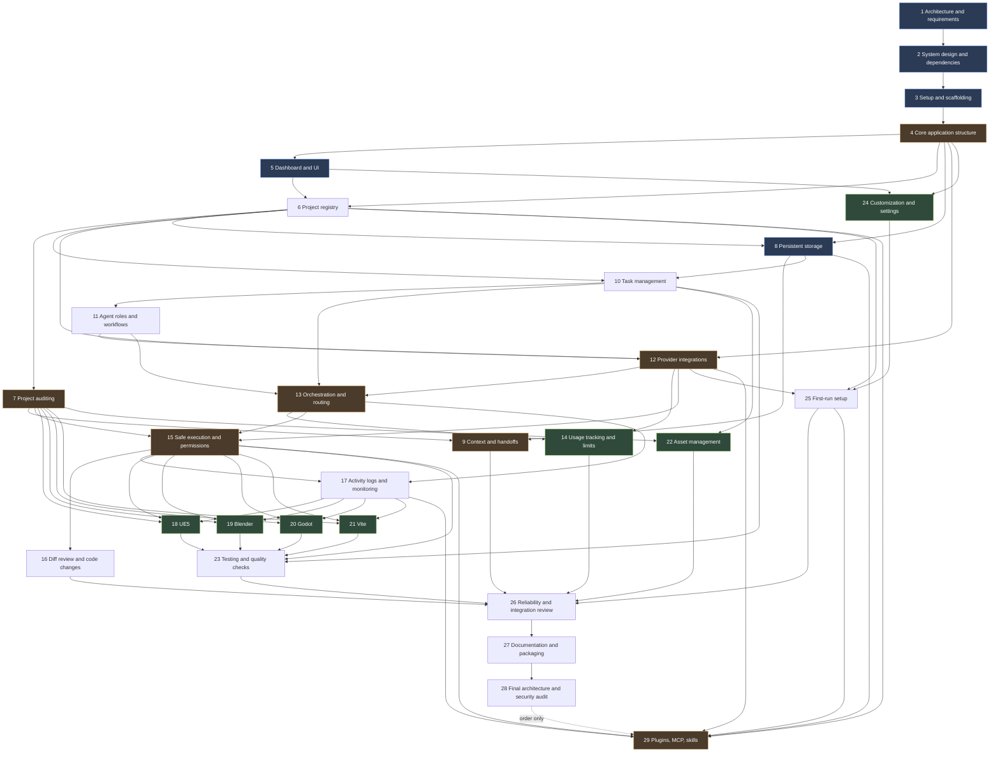

# Roadmap: GameDev Command Center

The app is built in the 29 steps from the user's table in [MASTER_SPEC.md](MASTER_SPEC.md) (the source of truth). Each step runs in its own project thread, in order, on top of the latest `main`; every finished step is tagged `step-NN` as a rollback point. A step is finished only when its acceptance criteria are tested and its notes are updated (see [CLAUDE.md](../CLAUDE.md)).

Step numbers are the user's build steps, not spec section numbers. "§N" below means a spec section. [REQUIREMENTS.md](REQUIREMENTS.md) maps every spec section and acceptance criterion to the steps that own it.

## Milestones

| Milestone | Steps | Done when |
|---|---|---|
| M0 Plan | 1–2 | Roadmap, requirements trace, architecture and pinned dependencies are written and checked |
| M1 Foundation | 3–5 | A secure Electron app launches with core services (IPC, logs, SQLite, settings, process runner) and the full UI shell |
| M2 Project core | 6–10 | Projects can be registered, audited, documented and planned with tasks, and the data is recoverable |
| M3 AI and safe workflow | 11–17 | Real provider adapters, routing, usage limits, permission gates, diff review and a live activity view |
| M4 Engines and content | 18–23 | UE5, Blender, Godot and Vite adapters, asset inventory and the test runner |
| M5 MVP completion | 24–26 | Settings, first-run wizard, and the §27 acceptance criteria tested end to end |
| M6 Release | 27–28 | Packaged Windows build and a final architecture and security audit |
| M7 Tooling | 29 | Tool registry, MCP management, bootstrap wizard and skills (§29) |

Spec phases (§24) map onto steps like this: Phase 0 is Steps 1–2. Phase 1 (MVP) is Steps 3–10, 12, 17, 24 and 25. Phase 2 is Steps 15 and 16 (plus Git reads in 7 and handoffs in 9). Phase 3 is Steps 11, 13 and 14. Phase 4 is Steps 18–21. Phase 5 is Steps 22–23 plus improvements inside 7, 10, 11 and 17. Phase 6 is Steps 27–28.

## Dependency map

Arrows point from a step to the steps that need it. Every arrow goes forward, so the user's order is a valid build order.

### Classification

- **Foundational** (blue): Steps 1–5, 8 and 15. Everything else stands on the design, the scaffold, the core services, the UI shell, recoverable data and the permission gate. Defects here are fixed before moving on.
- **Can be developed independently** (green): Steps 18, 19, 20 and 21 do not depend on each other. Steps 14, 22 and 24 only need earlier core steps and nothing from the agent work around them. Steps 9 and 10 do not depend on each other. The user chose one thread at a time, so these still run in order; the point is that a failure in one does not block the others.
- **Split into sub-tasks** (amber): Steps 4, 7, 9, 12, 13, 15 and 29 are too large for one change. Each lists numbered sub-tasks; commit after each one, and stop and report if the thread runs low on context. Step 29 is the largest and may take several sessions in its thread.

### Ordering conflicts and how the roadmap resolves them

The user's step order differs from the spec's phase order in a few places. The roadmap keeps the user's order and applies these rules (also recorded in [DECISIONS.md](DECISIONS.md)):

1. **Storage before the registry.** Step 6 needs persistence but Step 8 comes later. Step 4 builds the SQLite foundation (database, migrations, backup before migrating, settings store, activity table). Step 8 then adds backups, export/import, corruption handling and recovery.
2. **No agent writes before the safety gate.** Steps 11–14 come before Step 15. Until Step 15 is done, agent runs are read-only (plan or question modes only) and every write-capable control is disabled and labeled.
3. **Phase 1 items that land late.** The activity log page (17), settings page (24) and first-run wizard (25) come after Phase 2–3 work. Steps 4 and 5 give an early minimal settings store and a recent-activity list, so the app stays useful in between. The §27 acceptance test runs in Step 26.
4. **Git has no step of its own.** Read-only Git status and history are in Step 7, pre-write checks and `git init` offers in Step 15, and diff, revert, checkpoints and worktrees in Step 16.
5. **Resource monitoring is needed by routing.** The resource monitor service is built in Step 13 (it feeds the local-inference policy) and shown in the UI in Step 17.
6. **§19 Backrooms mode has no step of its own.** Generic pieces (subsystems, scope tiers, risk register) are in Step 10; the Backrooms profile itself is in Step 18.
7. **Step 29 comes after the final audit.** Step 29 is the riskiest feature (it installs third-party code), so it ends with its own focused security review.

### Rules every feature step follows

- Adds its settings keys to the settings schema with defaults, records activity events for user-visible actions, and (from Step 8 on) registers its tables for export/import.
- Adds or updates its entry in the feature-status manifest (from Step 5) so the UI and the Implementation Status page stay honest, and adds its dashboard card when the feature has dashboard data.
- Verifies uncertain CLI flags, file locations and APIs against current official documentation at the start of the step and records source and date in DECISIONS.md.
- Never writes to the user's real game projects. Tests use fixture projects under `test/fixtures` or temp folders. The Backrooms project may be registered and audited read-only for manual checks.

## Step plans

### Step 1 · Overall architecture and requirements
- **Model / effort:** Opus · Extra High
- **Spec sections:** §1–§3, §24 (Phase 0 planning), §25, §26, §28, §30
- **Goal:** Turn the master spec into a dependency map, an ordered roadmap, a requirements trace and permanent working rules, so every later step starts from a shared, checked plan.
- **Depends on:** None
- **Scope:**
  - Preserve the spec verbatim with a hash check.
  - Inspect the workspace and installed tools.
  - Map every spec section and acceptance criterion to steps.
  - Write the dependency map, classification and 29 plan blocks.
  - Record the high-level stack decision (spec-preferred stack) and the alternatives considered.
  - Create CLAUDE.md and the progress notes; add a dependency-free docs check.
- **Acceptance criteria:**
  - `docs/MASTER_SPEC.md` holds the spec verbatim and `node scripts/check-docs.mjs` confirms its hash.
  - Every spec section §1–§30, every §27 criterion and every §29K criterion is traced to at least one step.
  - 29 step blocks exist with goal, dependencies, acceptance criteria and the model and effort from the user's table; no step depends on a later step.
  - CLAUDE.md, STATUS.md, DECISIONS.md, KNOWN_ISSUES.md and CHANGELOG.md exist; README and LICENSE are preserved.
  - `node --test scripts/check-docs.test.mjs` passes, including the negative cases.
  - Committed, tagged `step-01` and pushed.
- **Out of scope:** dependency versions, folder structure and any application code.

### Step 2 · System design and dependencies
- **Model / effort:** Opus · Extra High
- **Spec sections:** §4, §9 (provider contract), §11 (single writer), §14 (permission model), §16 (integration interface), §22, §23, §24 (Phase 0 design), §28
- **Goal:** Produce the detailed technical design and a verified, pinned dependency set, so Step 3 can scaffold without guessing.
- **Depends on:** Step 1
- **Scope:**
  - Verify current stable versions and compatibility from official sources and record version, source, date and license for: Electron, the build tooling (for example electron-vite versus Electron Forge with Vite), React, TypeScript, Vite, the SQLite binding (for example better-sqlite3 versus `node:sqlite` in Electron's Node), Zod, logging, Vitest, Playwright for Electron end-to-end tests, linting and formatting, the UI component approach, the packaging tool and whether a terminal stack (node-pty and xterm.js) is needed.
  - Resolve the Node.js runtime: the PC has v20.18.1, which is end-of-life and below Vite's minimum (KNOWN_ISSUES KI-001). Recommend an LTS line and ask the user before installing anything machine-wide.
  - Write `docs/ARCHITECTURE.md`: process model; folder tree for the 13 modules in §4; TypeScript interface sketches for ProviderAdapter (§9), ProjectIntegration (§16), ProcessRunner, repositories, Logger and PermissionGate; the IPC pattern (channel registry with Zod schemas, no generic filesystem or shell channels); the security model (context isolation, sandbox, no Node in the renderer, CSP, navigation and window-open limits, §14 permission scopes, sensitive-path denylist, redaction); data model v1 and the migration and backup policy; the feature-status manifest; error model; logging (persistent, rotated, redacted); process ownership and shutdown; testing strategy (unit, integration, end-to-end; mock providers only under `test/`).
  - Expand README with what the app is and where things are.
  - Record each choice as an ADR in DECISIONS.md with the alternatives considered.
- **Acceptance criteria:**
  - Every dependency has a pinned version, official source, verification date and license recorded.
  - Every §4 module has an owning folder and an interface sketch; the security model covers every rule in §4 and §14.
  - The IPC design forbids arbitrary filesystem and shell access from the renderer.
  - The testing strategy says what runs in `npm test` and what runs end to end.
  - The Node.js decision is recorded, with the user's approval if an install is needed.
  - The docs check passes; no application code is written.
- **Out of scope:** scaffolding the app.

### Step 3 · Project setup and scaffolding
- **Model / effort:** Sonnet · High
- **Spec sections:** §4, §23, §24 (Phase 1 run command), §27.1, §27.10, §30 (Git)
- **Goal:** A minimal Electron + React + TypeScript + Vite app that launches on Windows with secure defaults and working dev, test, lint and build commands.
- **Depends on:** Step 2
- **Scope:**
  - Scaffold from the template chosen in Step 2 and commit the lockfile.
  - Strict TypeScript, linting and formatting, Vitest.
  - Secure window: context isolation, sandbox, Node integration off, CSP, blocked navigation and new windows; an empty typed preload bridge.
  - `.gitignore` for dependencies, build output, databases, logs and env files.
  - npm scripts: `dev`, `build`, `typecheck`, `lint`, `test`, `check:docs` (wrapping the Step 1 check).
  - README: how to install and run on Windows.
  - Use `assets/icon/nexus-ai.ico` (source `nexus-ai.png`) as the window and app icon, and make `scripts/launch.cmd` (the desktop shortcut target) start the dev app.
- **Acceptance criteria:**
  - A clean clone installs and `npm run dev` opens the window on Windows.
  - `typecheck`, `lint`, `test` and `build` pass.
  - A test asserts the window's security settings; the renderer has no `require` or `process` access; CSP is present.
  - The docs check passes.
- **Out of scope:** features and the database.

### Step 4 · Core application structure
- **Model / effort:** Sonnet · High
- **Spec sections:** §4 (modules, IPC), §14 (redaction), §22 (SQLite, migrations, transactions), §23 (typed errors, shutdown, process ownership, log growth)
- **Goal:** Build the foundations every feature uses: typed IPC, errors, logging, SQLite with migrations, a settings store, activity events and a safe process runner.
- **Depends on:** Step 3
- **Sub-tasks:**
  - 4.1 Typed IPC: channel registry, Zod-validated requests and responses in main, minimal `window.api` through the preload bridge, typed errors with actionable messages.
  - 4.2 Logging: persistent log in the app's user-data folder, levels, size-based rotation, a shared secret-redaction utility and sensitive-path denylist (env files, keys, credential files) reused by later scanning.
  - 4.3 SQLite: database in user data, migration runner with a schema version, backup copy before each migration, never replace an existing database silently, transaction helper, integrity check on open with a clear recovery message.
  - 4.4 Settings store (Zod schema with defaults; invalid values fall back with a warning) and an activity events table with a `recordActivity` API.
  - 4.5 Process runner in main only: argument arrays (no shell strings), timeout, output cap, cancellation, ownership registry, cleanup on quit. Nothing lets the renderer run arbitrary commands.
  - 4.6 Graceful shutdown path.
- **Acceptance criteria:**
  - Unit tests cover IPC validation (malformed input rejected), redaction, migrations (fresh, upgrade, backup created, a failed migration leaves the original intact), settings fallback, and the process runner (timeout, cancel, output cap, cleanup).
  - The app creates its database and log on first start and keeps data across a restart.
  - All quality gates pass.

### Step 5 · Dashboard and UI
- **Model / effort:** Sonnet · High
- **Spec sections:** §5, §20 (layout), §27.8, §27.11
- **Goal:** The polished application shell used every day, with honest empty states and clearly labeled upcoming features.
- **Depends on:** Step 4
- **Scope:**
  - Design tokens: dark neutral theme, restrained accent, typography, spacing, density; the component approach from Step 2.
  - Persistent collapsible sidebar with the 11 sections from §5; top bar with the project switcher (empty until Step 6); searchable command palette; resizable panels; optional right inspector; keyboard navigation and visible focus.
  - Feature-status manifest (available, requires setup, upcoming) that drives "Upcoming" labels and an Implementation Status page listing every roadmap step (§27.11).
  - Dashboard frame with real recent activity from Step 4 and empty states for later cards.
- **Acceptance criteria:**
  - A test confirms every navigation item and action is either wired or labeled Upcoming through the manifest.
  - The command palette opens from the keyboard and runs navigation actions; sidebar and panel sizes persist across restart.
  - The layout works from 1280×720 upward; component tests cover the palette and navigation.
  - All quality gates pass.
- **Out of scope:** project data and real dashboard metrics.

### Step 6 · Project registry
- **Model / effort:** Sonnet · High
- **Spec sections:** §6, §20 (pause a project), §27.2, §27.3
- **Goal:** Register existing projects by folder without moving or modifying them, with evidence-based type detection and manual override.
- **Depends on:** Step 4, Step 5
- **Scope:**
  - Projects table with the §6 fields (name, description, type, engine, path, status including paused, tags, instructions, AI preferences, backup settings).
  - Add through a native folder picker in main; validate paths; reject duplicates; handle missing folders.
  - Read-only detection from real files (`.uproject`, `project.godot`, `package.json` with Vite config, `.sln`/`.csproj`, Unity `ProjectSettings/ProjectVersion.txt`, `.blend`) with the evidence stored; never from the folder name; manual override.
  - Only registered folders are ever inspected. Removing a project from the registry never touches its files.
  - Projects page, working project switcher, activity events.
- **Acceptance criteria:**
  - Detection tests with fixture folders for each type, including a folder named "unreal" that only holds a `package.json` (detected as web, not Unreal).
  - A test shows registering a project changes no file (timestamps and hashes unchanged).
  - Projects and overrides persist across restart; removal leaves the folder intact.
  - All quality gates pass.

### Step 7 · Project auditing
- **Model / effort:** Sonnet · High
- **Spec sections:** §7 (audit), §6 (read-only discovery), §14 (sensitive files), §20 (recent commits), §27.3, §27.4
- **Goal:** A read-only, evidence-based audit report for a registered project.
- **Depends on:** Step 6
- **Sub-tasks:**
  - 7.1 Bounded scanner: stays inside the registered folder, skips heavy and generated folders (for example `.git`, `node_modules`, `Intermediate`, `Saved`, `DerivedDataCache`, `Binaries`, `.godot`, `Library`), skips sensitive paths, never reads binary contents, has file-count, depth and time budgets.
  - 7.2 Analyzers: engine and version where detectable, languages, major folders, entry points, existing docs, build and test commands actually present, asset folders and type counts, documented unfinished work, import or include relationships (heuristic), identical-file duplicates, risks and missing information.
  - 7.3 Read-only Git service through the process runner: repository or not, branch, ahead/behind, uncommitted changes, recent commits; missing Git handled.
  - 7.4 Audit report UI with expandable sections and file links (reveal in Explorer through validated IPC). Every finding is marked Confirmed (with its evidence path) or Inferred. Audits are stored with timestamps and can be re-run.
- **Acceptance criteria:**
  - Fixture tests for each analyzer; scanner tests prove sensitive files are skipped and budgets hold.
  - Auditing a folder without Git reports "Not a Git repository" instead of failing.
  - The report separates confirmed facts from inference, and running an audit changes no file.
  - All quality gates pass.

### Step 8 · Persistent storage
- **Model / effort:** Sonnet · High
- **Spec sections:** §22, §27.6, user note "Backups and migrations"
- **Goal:** Make application data recoverable with backups, validated export and import, corruption handling and recovery guidance.
- **Depends on:** Step 4, Step 6
- **Scope:**
  - Document the schema.
  - Manual and optional scheduled database backups with a retention cap; restore with confirmation that first backs up the current database.
  - Export settings, projects and every registered table to versioned JSON; import with Zod validation, a preview and conflict handling; never overwrite silently.
  - Startup integrity check and handling of a database newer than the app (refuse writes, explain).
  - A recovery guide; a table-registration hook so later tables join export automatically.
- **Acceptance criteria:**
  - Export then import round-trips exactly; invalid or hostile imports are rejected with clear errors.
  - A corrupted database is detected, the original is kept, and restore is offered.
  - Restore keeps a copy of the pre-restore database; backups never contain project content.
  - Data survives closing and reopening the app (§27.6).
  - All quality gates pass.

### Step 9 · Context and session handoffs
- **Model / effort:** Sonnet · High
- **Spec sections:** §7 (context packs), §8, §14 (keep secrets out of context)
- **Goal:** Persistent project memory, task-specific context packs with preview, and session handoffs.
- **Depends on:** Step 7, Step 8
- **Sub-tasks:**
  - 9.1 Project memory: inspect existing doc conventions first and propose a minimal compatible set from §8; storage choice (app database by default, inside the project, or a configured docs folder); in-app editing; incremental updates; a diff preview and explicit confirmation before any write into a project folder.
  - 9.2 Context pack builder: from a task description, select relevant files, docs, conventions, decisions and related tasks using audit data; exclude binaries, generated files and sensitive paths; size budget with a token estimate clearly labeled as an estimate; preview listing every file and the destination before anything is sent to a cloud provider; saved packs that report when included files change.
  - 9.3 Session handoff generator with the seven §8 fields, saved per project; the latest one shows on the dashboard.
- **Acceptance criteria:**
  - Sensitive files never enter a context pack, even when picked by hand; binaries and huge files are excluded.
  - Changing an included file marks its pack stale.
  - A project write happens only after preview and confirmation and writes exactly the previewed content (verified by reading back); existing docs are never overwritten without preview.
  - Handoffs contain all seven fields; tests write only to fixture projects.
  - All quality gates pass.

### Step 10 · Task management
- **Model / effort:** Sonnet · High
- **Spec sections:** §10, §19 (generic parts), §20 (progress, portfolio, milestones), §27.5
- **Goal:** A game-development task manager with a real lifecycle, board, list and roadmap views, milestones and honest progress.
- **Depends on:** Step 6, Step 8
- **Scope:**
  - Tasks with every §10 field; lifecycle Inbox, Planned, Ready, In Progress, Review, Testing, Done plus Blocked, Cancelled and Failed with valid transitions; dependencies without cycles; milestones as parents; plan-approval flag before code changes.
  - Kanban, list and milestone roadmap views over the same data; notes; task templates for the nine §10 categories.
  - Explainable next-task recommendation (priority, satisfied dependencies, open bugs, current milestone).
  - Manual plain-language-to-tasks breakdown form (AI help arrives in Step 12).
  - Generic §19 pieces: subsystem field, scope tiers (long-term dream, first playable, vertical slice, release) and a bugs and risks register per project.
  - Dashboard: current milestone, progress from stored tasks only, active and blocked tasks, portfolio across projects, milestone snapshots; tasks join export.
- **Acceptance criteria:**
  - Tests cover lifecycle transitions, cycle rejection, recommendation order and progress computed only from stored tasks.
  - Tasks and milestones persist across restart and through export and import.
  - All quality gates pass.

### Step 11 · Agent roles and workflows
- **Model / effort:** Sonnet · High
- **Spec sections:** §11, §10 (suggested role and provider), §12 (per-role selection)
- **Goal:** Define agent roles, their default permissions and the visible workflow states, without launching any agent yet.
- **Depends on:** Step 10
- **Scope:**
  - Role registry for planner/architect, implementer, reviewer, QA/debugging, documentation and asset/level-design assistant: purpose, prompt template, expected output and default permission (read-only for all but the implementer).
  - Agent run records linked to tasks with the orchestration states queued, planning, awaiting approval, running, awaiting review, testing, completed, failed and cancelled, and their valid transitions.
  - Workflow templates (plan, approve, implement, review, test) where reviewer and tester are optional and show the expected action and provider before anything runs.
  - Task detail UI for choosing roles. Run buttons stay labeled Upcoming until Steps 12 and 13.
- **Acceptance criteria:**
  - State-machine tests; the implementer is the only write-capable role and needs an approved plan.
  - Reviewer and QA roles are never added automatically.
  - A test proves this step spawns no process.
  - All quality gates pass.

### Step 12 · Provider integrations
- **Model / effort:** Sonnet · High
- **Spec sections:** §9, §10 (plain-language breakdown), §24 (Phase 1 detection), §27.7, §27.9
- **Goal:** Real, capability-detected adapters for Ollama, Claude Code and Codex CLI behind one typed provider interface.
- **Depends on:** Step 4, Step 6, Step 11
- **Sub-tasks:**
  - 12.1 Provider interface and capability model from Step 2; a mock provider that lives only under `test/`.
  - 12.2 Ollama through its documented local API: configurable endpoint, health and version, model list and metadata, optional user-triggered warm-up, streaming generation, cancellation, context-length option, timeouts and diagnostics. Model downloads only after showing the size (when available) and getting approval.
  - 12.3 Claude Code: detect install and version, explain sign-in, run sessions in the project folder through documented non-interactive flags with structured output (verify in current docs), stream events, exit codes and errors. Read-only or plan modes only until Step 15. Never read credentials.
  - 12.4 Codex CLI: optional and independent; detection and documented non-interactive mode under the same read-only rule.
  - 12.5 Integrations page: not installed, installed, needs setup, working or error, with actionable messages; quotas show "Unavailable from this provider" unless a documented source returns them.
  - 12.6 First consumer: AI-assisted task breakdown and doc drafting with a manually chosen provider, always previewed and never applied automatically.
- **Acceptance criteria:**
  - Adapter tests with recorded responses; live checks against the Ollama and Claude Code installed on this PC, with results (including failures) recorded in STATUS.md.
  - A missing or stopped tool gives a clear error, never fake success.
  - No hosted call happens without showing the destination; no write-capable agent run is possible (test).
  - All quality gates pass.

### Step 13 · Agent orchestration and routing
- **Model / effort:** Opus · Extra High
- **Spec sections:** §11 (single writer, states), §12 (routing, retries), §13, §15 (command queue)
- **Goal:** Route tasks to roles and providers transparently, queue agent runs safely, and respect hardware limits for local inference.
- **Depends on:** Step 10, Step 11, Step 12
- **Sub-tasks:**
  - 13.1 Routing profiles Manual, Local First, Balanced and Cloud First, with per-role provider and model overrides. The routing choice and any known paid or metered usage are shown before cloud work. No automatic second or third call.
  - 13.2 Run queue with priorities, cancellation and duplicate-launch prevention; a per-project single-writer lock that survives restarts; read-only runs may run alongside when safe; bounded timeouts and retries; approval before escalating to a more expensive model or repeating a failed cloud call.
  - 13.3 Resource monitor (CPU and RAM from the OS, GPU and VRAM from `nvidia-smi` when present, configurable interval, graceful absence) and the local-inference policy: Prioritize Game Performance and Allow Local Inference modes, minimum free VRAM and RAM thresholds, heavy-workload detection (Unreal Editor, Blender) that warns and holds instead of starting, pause and cancel for local generation, unloading idle models only through documented Ollama options. Never terminate other applications.
- **Acceptance criteria:**
  - Tests cover routing per profile, the writer lock (blocks a second writer, survives restart), duplicate-launch rejection, bounded retries and approval for escalation.
  - The resource parser handles sample outputs and a missing `nvidia-smi`; the policy blocks a local start below thresholds and shows a warning.
  - Cancellation stops only processes the app owns.
  - All quality gates pass.

### Step 14 · Usage tracking and limits
- **Model / effort:** Sonnet · High
- **Spec sections:** §12 (usage log, budgets, no fabricated numbers)
- **Goal:** An honest local usage log and enforceable launch limits.
- **Depends on:** Step 12, Step 13
- **Scope:**
  - Usage log with task, provider, model if known, timestamps, status, and usage or cost only when an authorized source returns it.
  - Parse provider-reported usage only where documented (verify per provider).
  - Configurable limits on cloud launches per day, project and task, and on retries, enforced before launch with a clear reason.
  - Usage page and dashboard summary; never switch to metered API billing.
- **Acceptance criteria:**
  - Missing usage stays empty and shows "Unavailable from this provider", never zero or a guess.
  - Limits block launches and record why; usage rows persist and export.
  - All quality gates pass.

### Step 15 · Safe execution and permissions
- **Model / effort:** Opus · Extra High
- **Spec sections:** §14, §26, user note "Approval before risky actions"
- **Goal:** Make agent writes and commands safe with scoped permissions, approvals, pre-write checks and secret protection, and only then enable write-capable agent runs.
- **Depends on:** Step 7, Step 12, Step 13
- **Sub-tasks:**
  - 15.1 Permission scopes (read-only audit, approved project writes, approved commands, explicitly approved destructive operations) per project and task; approvals stored with what, where and when. Only a user action in a main-process dialog can grant a scope; agents and the renderer cannot.
  - 15.2 Pre-write gate: Git status, uncommitted-work warning, likely change scope, confirmation, and a record of the approved task and working folder; offer `git init` with an explanation when Git is missing (never touch existing config); optional named checkpoint before larger changes.
  - 15.3 Approved commands: per-project allowlist of discovered commands approved by the user; destructive patterns (recursive deletes, `git reset`, `git clean`, force checkout, history rewrites, formatting drives) need the destructive scope; no shell string building.
  - 15.4 Secret protection: context denylist, redaction in logs, previews and session output; credentials never stored in normal settings.
  - 15.5 Enable write-capable Claude Code and Codex runs through the gate while keeping the CLIs' own permission prompts.
- **Acceptance criteria:**
  - Tests: an agent or renderer attempt to raise its own permission is rejected; destructive commands are blocked without explicit approval; the gate warns on a dirty tree; uncommitted work is never discarded; redaction catches sample secrets.
  - The first write-capable run is tested on a small throwaway code project (§24 Phase 2), never the Backrooms project.
  - Security notes are added to DECISIONS.md; all quality gates pass.

### Step 16 · Diff review and code changes
- **Model / effort:** Sonnet · High
- **Spec sections:** §14 (diff, approve, reject, revert, checkpoints, binaries), §11 (worktrees), §20 (recent changes)
- **Goal:** Review what an agent changed and accept, reject or revert it safely, with Git as the recovery mechanism.
- **Depends on:** Step 15
- **Scope:**
  - Change tracking per session against a recorded base; unified diff for text files (additions, changes, deletions); binary files listed with size and a notice.
  - Approve (commit), reject (restore only the session's files after confirmation, keeping other uncommitted work) and revert committed changes with `git revert`, never reset.
  - Named checkpoints; a warning that Git may not protect large binaries (detect Git LFS).
  - Optional isolated worktrees for independent tasks, created and removed only with approval and tied to the writer lock.
  - Git and Changes page: status, branches, recent commits.
- **Acceptance criteria:**
  - Tests on temporary repositories: diffs are accurate; reject restores only the session's files and keeps the user's earlier edits; revert keeps history; worktree actions are guarded.
  - All quality gates pass.

### Step 17 · Activity logs and monitoring
- **Model / effort:** Sonnet · High
- **Spec sections:** §15, §13 (resource display), §20 (resource warnings, outstanding approvals), §27.8
- **Goal:** Make activity visible with a live session view, searchable history, a log viewer and a resource panel.
- **Depends on:** Step 13, Step 15
- **Scope:**
  - Activity and Logs page with filters, search and redacted export.
  - Live session page with the §15 fields, showing only observed facts and labeling what the provider does not expose; session metadata persists; resume only where the provider officially supports it.
  - Command queue view with priorities and cancel; resource panel and dashboard warnings; outstanding approvals on the dashboard.
  - Log retention limits and a redacted diagnostics bundle.
- **Acceptance criteria:**
  - Session records survive restart; the view never shows a state without an observed event.
  - Retention caps hold and exports are redacted.
  - All quality gates pass.

### Step 18 · UE5 integration
- **Model / effort:** Sonnet · High
- **Spec sections:** §16 (Unreal Engine 5), §19 (Backrooms profile), §29D (Unreal research inputs)
- **Goal:** An Unreal Engine 5 adapter for discovery, context, opening and approved command launches, plus the optional Backrooms game profile.
- **Depends on:** Step 7, Step 15, Step 17
- **Scope:**
  - Implement the shared ProjectIntegration interface for Unreal: `.uproject` and EngineAssociation, installed engines (verify where the launcher and source builds register them), Source, Config, Content and Plugins folders.
  - Open the project and folders; launch the editor and build commands (verify UnrealBuildTool and RunUAT usage in current docs) only through the Step 15 gate; capture build and automation logs.
  - Unreal-specific context for packs; record asset paths without editing binary assets; planning templates for Blueprints, C++, levels, materials, lighting, AI, audio and performance.
  - Editor Python or other editor automation stays an opt-in, disabled feature with its own permission, preview and recovery until it is tested.
  - Backrooms profile (§19): the §19 domains as subsystems confirmed against the real design and audit before use, scope tiers, a horror-quality checklist (lighting, composition, materials, sound, layout, pacing, atmosphere, performance) and risk flags for multiplayer, procedural generation and large content plans.
  - Capability report: implemented, unavailable or awaiting configuration.
- **Acceptance criteria:**
  - Fixture `.uproject` tests; engine discovery handles "none installed".
  - A live check on this PC is reported honestly; the Backrooms project is only read, never written.
  - All quality gates pass.

### Step 19 · Blender integration
- **Model / effort:** Sonnet · High
- **Spec sections:** §16 (Blender), §17 (asset briefs)
- **Goal:** A Blender adapter that finds scenes and installations and runs approved headless operations without risking the user's files.
- **Depends on:** Step 7, Step 15, Step 17
- **Scope:**
  - Detect `.blend` files and Blender installations (configured path and common install folders, not only PATH).
  - Open scenes; run approved scripts through Blender's documented command line in background mode (verify flags), on copies whenever a script could save.
  - Track important asset files; generate asset briefs and naming conventions; record export results and errors; write import handoff notes for the target engine.
- **Acceptance criteria:**
  - Detection tests; a headless run is tested if Blender is installed, otherwise reported as not run.
  - A test proves original `.blend` files are never overwritten.
  - All quality gates pass.

### Step 20 · Godot integration
- **Model / effort:** Sonnet · High
- **Spec sections:** §16 (Godot)
- **Goal:** A Godot adapter that uses the project's real configuration and installed engine version.
- **Depends on:** Step 7, Step 15, Step 17
- **Scope:**
  - Parse `project.godot` (name, features and version hints) and `export_presets.cfg`; configure the Godot executable and read its real version.
  - Launch the editor; run approved headless, test and export commands (verify current command-line options); collect GDScript context; capture output.
- **Acceptance criteria:**
  - Fixture tests for parsing; commands come only from discovered configuration, never invented.
  - A live run is tested if Godot is installed, otherwise reported as not run.
  - All quality gates pass.

### Step 21 · Vite.js integration
- **Model / effort:** Sonnet · High
- **Spec sections:** §16 (Vite and web games)
- **Goal:** A Vite and web adapter that discovers and runs the project's own scripts safely.
- **Depends on:** Step 7, Step 15, Step 17
- **Scope:**
  - Detect `package.json`, Vite config and the package manager from the lockfile; list scripts and dependencies.
  - Run approved dev-server, lint, type-check, test, build and preview scripts; dev servers are owned processes that can be stopped, with port detection.
  - Never reinstall dependencies or change versions on its own; installs only with approval and lockfile-respecting commands.
- **Acceptance criteria:**
  - Fixture Vite project: exact script discovery; the dev server starts and stops with process cleanup; scripts that were not discovered are refused.
  - All quality gates pass.

### Step 22 · Asset management
- **Model / effort:** Sonnet · High
- **Spec sections:** §17, §8 (asset register), §6 (asset inventory)
- **Goal:** A searchable asset inventory with previews, briefs and naming checks that never moves files on its own.
- **Depends on:** Step 7, Step 10
- **Scope:**
  - Metadata-only index (path, category, size, modified time) with incremental rescans for the §17 categories; tags, notes and task references; search.
  - Previews for common image formats through a protocol limited to registered project folders; metadata only for engine binary formats.
  - Naming and folder-organization checks (report only); asset brief generator (requirements, scale, use, formats, textures, performance, engine integration); `ASSET_REGISTER.md` export with preview.
  - Moves, renames, deletes and reimports only with preview, confirmation and the Step 15 scope. No claims of generating 3D models; future generators are separate optional adapters.
- **Acceptance criteria:**
  - Categorization tests; sensitive paths are excluded; previews refuse files outside registered projects (path traversal test); large scans stay within budgets.
  - All quality gates pass.

### Step 23 · Testing and quality checks
- **Model / effort:** Sonnet · High
- **Spec sections:** §18, §20 (failed tests, release checklists), §27.10
- **Goal:** A test runner and definition-of-done system that never reports success it did not observe.
- **Depends on:** Step 10, Step 15, Step 18, Step 19, Step 20, Step 21
- **Scope:**
  - Definition of done per task (automated tests, build or type-check, manual steps, expected output, limitations, regression risks).
  - Test runner using commands discovered by the engine adapters and project scripts, run only when approved; results stored with timestamp, logs, exit code and commit or working-tree state.
  - Statuses Passed, Failed, Not run, Unsupported and Inconclusive; a started command is not a pass; static and command-line checks are kept separate from in-editor playtests (recorded manually).
  - Reusable checklists for gameplay, performance, visual quality, audio, UI, level design and release; no feature counts as verified only because code was generated.
  - Testing page and failed tests on the dashboard.
- **Acceptance criteria:**
  - Tests for status classification (timeout or kill is Inconclusive, non-zero exit is Failed, unsupported is Unsupported) and result persistence.
  - The app's own test suite runs through the runner when the app's repository is registered as a project (§27.10).
  - All quality gates pass.

### Step 24 · Customization and settings
- **Model / effort:** Sonnet · High
- **Spec sections:** §21, §5 (theme, density), §23 (backward-compatible settings)
- **Goal:** A complete settings page where every §21 setting is real and validated.
- **Depends on:** Step 4, Step 5
- **Scope:**
  - Every §21 item: theme and accent, density, font size, default project, project paths, engine installations, provider configuration, model preferences, context limits, agent permissions (changes follow Step 15 rules), local inference safeguards, logging verbosity, backups, default task templates, automatic handoffs, notifications, keyboard shortcuts with conflict detection, feature flags for experimental integrations.
  - Validation, settings migration between versions, settings export and import through Step 8.
- **Acceptance criteria:**
  - Each setting category has a test showing it takes effect; invalid input is rejected; old settings versions migrate.
  - Experimental features stay off until their dependencies and permissions exist.
  - All quality gates pass.

### Step 25 · First-run setup and onboarding
- **Model / effort:** Sonnet · High
- **Spec sections:** §21 (guided first run), §24 (Phase 1 wizard), §27.1, §27.2
- **Goal:** A guided, skippable first-run wizard that gets a beginner to a useful dashboard.
- **Depends on:** Step 6, Step 12, Step 24
- **Scope:**
  - Welcome and data location; read-only detection of Git, Node.js, Ollama, Claude Code, Codex, `nvidia-smi`, Unreal, Blender and Godot with plain-language explanations; optional path configuration.
  - Add the first project (never moved or modified); choose a routing profile and local-inference mode; summary.
  - Skippable and re-runnable from Settings; the app stays useful with no integrations; optional features stay off until their dependencies exist.
- **Acceptance criteria:**
  - End-to-end test: fresh profile, wizard, add a fixture project, dashboard shows it.
  - Skipping works; re-running does not duplicate data; detection failures are shown clearly.
  - All quality gates pass.

### Step 26 · Complex reliability and integration review
- **Model / effort:** Opus · Extra High
- **Spec sections:** §3, §23, §26, §27
- **Goal:** Prove the MVP works end to end on Windows and fix the reliability problems that only show up when everything runs together.
- **Depends on:** Step 9, Step 14, Step 16, Step 22, Step 23, Step 25
- **Scope:**
  - Review process lifecycle (no orphans after quit or crash), cancellation ownership, duplicate launches, timeouts and retries, migration, backup and restore drills, corrupted configuration, log growth, memory over a long session and the quality of error messages.
  - Run every §27 criterion explicitly, with the real Backrooms project registered read-only for criteria 2–4, and record the evidence in `docs/ACCEPTANCE.md`.
  - Check that the dashboard answers the ten §3 questions with real data.
  - Integration matrix: each connector marked implemented, unavailable or awaiting configuration, with test evidence.
  - Fix defects within a bounded effort or record them in KNOWN_ISSUES.md.
- **Acceptance criteria:**
  - `docs/ACCEPTANCE.md` shows evidence for all eleven §27 criteria.
  - No open critical defect without a documented blocker.
  - All quality gates pass.

### Step 27 · Documentation and packaging
- **Model / effort:** Sonnet · High
- **Spec sections:** §24 (Phase 6), §29I (configurable app name)
- **Goal:** A reproducible Windows build with an icon, upgrade checks, local crash logging and beginner-friendly docs.
- **Depends on:** Step 26
- **Scope:**
  - Installer and/or portable build with the tool chosen in Step 2; icon (`assets/icon/nexus-ai.ico`, the Nexus AI icon) and metadata; configurable display name separate from the internal app id.
  - User data kept across upgrades; migration checks with backup on upgrade; local crash and error logging (no uploads); automated smoke test on the packaged build.
  - Reproducible build instructions, troubleshooting guide, README. No auto-updater that runs unverified updates.
- **Acceptance criteria:**
  - A clean clone reproduces the build; the packaged app launches on Windows and passes the smoke test.
  - Upgrading from the previous build migrates data with a backup.
  - All quality gates pass.

### Step 28 · Final architecture and security audit
- **Model / effort:** Opus · Extra High
- **Spec sections:** §4, §14, §26, §30 (security and privacy), user note "Approval before risky actions"
- **Goal:** Confirm the finished app matches its architecture and is safe before the tooling features are added.
- **Depends on:** Step 27
- **Scope:**
  - Electron security (context isolation, sandbox, CSP, every IPC channel validated, no arbitrary filesystem or shell access).
  - Permission escalation paths, secret handling and redaction, path traversal, command injection.
  - Dependency audit (vulnerabilities and licenses), data recovery, module boundaries against ARCHITECTURE.md, and a sweep for dead controls or fake features.
  - Fix high and critical findings; write `docs/SECURITY_AUDIT.md`.
- **Acceptance criteria:**
  - The audit report lists findings and resolutions; no unresolved high or critical issue.
  - All quality gates pass; the release candidate is tagged.

### Step 29 · Plugins, MCP servers, skills and automation
- **Model / effort:** Sonnet · High
- **Spec sections:** §29 (A–K)
- **Goal:** Help the user discover, install, verify and maintain development tooling safely, starting from the smallest useful set.
- **Depends on:** Step 6, Step 8, Step 12, Step 15, Step 17, Step 25
- **Sub-tasks:**
  - 29.1 Tool registry with the §29B fields; entries only for tools verified from official sources (unverified tools are marked and never installable); read-only discovery of installed tools and provider configuration (verify Claude Code and Codex config locations in official docs). Plugins, skills, MCP servers, subagents, hooks and CLI utilities stay separate categories (§29C).
  - 29.2 MCP management page (§29F): configured servers, source, scope, status, tools where discoverable, authentication needs and data-access implications; validation before enabling; health checks through harmless read-only operations; configured is never shown as working.
  - 29.3 Bootstrap wizard (§29A) with recommendation profiles (§29D) and safe installation (§29G): per-component approve, skip or defer; documented package managers and pinned versions; project-local first; no global changes or paid credentials without approval; verification after install; history and recovery path.
  - 29.4 Tool health dashboard (§29H) with reasonable check intervals and no automatic updates or removals.
  - 29.5 Skill generation (§29E): a few high-value skills, previewed, written to each agent's documented location.
  - 29.6 Naming and identity (§29I): configurable app name, internal id versus display name, project identity profiles, conflict checks within the registry, no trademark claims.
  - 29.7 Focused security review of the install and MCP code paths (this step runs after the Step 28 audit).
- **Acceptance criteria:**
  - Each §29K criterion (1–9) is tested with recorded evidence.
  - Tests prove nothing installs without approval and unverified tools cannot be installed; install history can restore earlier configurations where safe.
  - The security review is recorded; all quality gates pass.
